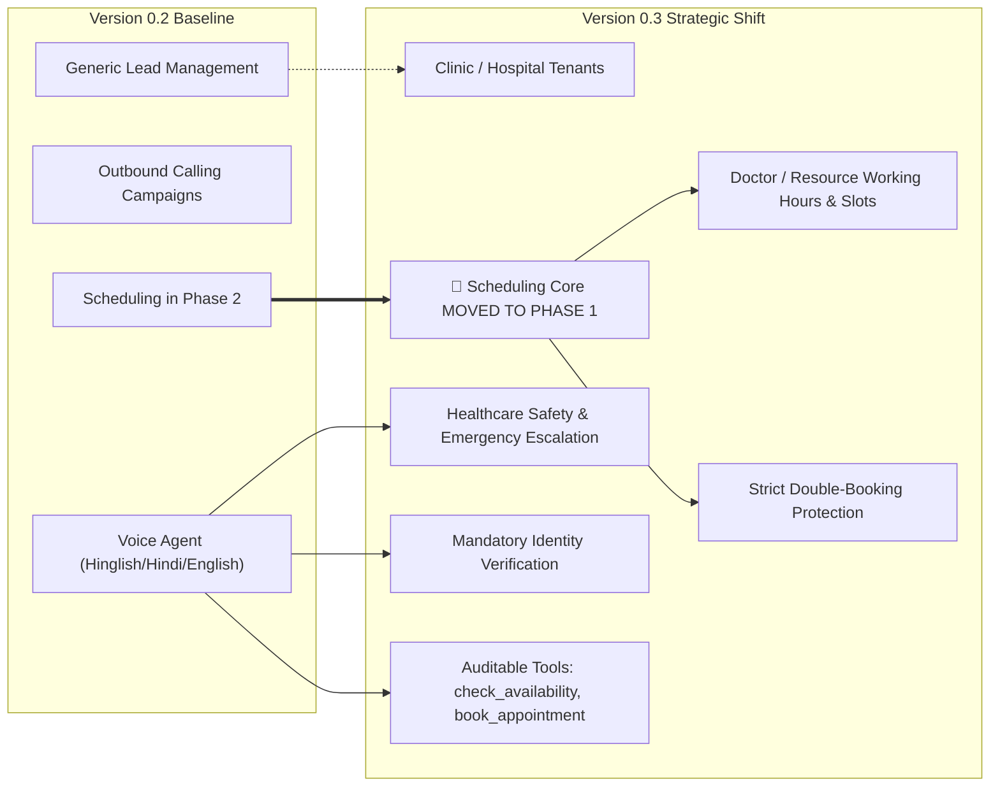

# Repository Progress Audit & Requirements Alignment (Version 0.3)

> **Document Type:** Technical Audit & Architectural Alignment  
> **Author:** Senior Software Architect & Lead Engineer  
> **Source Documents:** `Voice-AI-Agent.pdf` (Version 0.3, dated 3 November 2026), `VOICE_CALL_AI_REFERENCE.md`  
> **Scope:** Repository inspection, requirements delta analysis, traceability matrix, technology trade-offs, and 4-week delivery roadmap.

---

## 1. Overall Repository Progress

### 1.1 Completed Foundations
- **Repository Architecture**: Established a clean Modular Monolith layout under `voice-ai-agent/` with distinct `backend/`, `frontend/`, `infrastructure/`, `docs/`, and `.github/workflows/`.
- **FastAPI Core**: Async application factory (`app/main.py`), lifespan management, versioned router prefix (`/api/v1`), custom domain exception hierarchy (`AppException`), structured error handlers, and `RequestIDMiddleware` for distributed tracing.
- **Configuration Management**: Centralized Pydantic Settings v2 (`app/core/config.py`) loading `.env` variables with computed async (`postgresql+asyncpg://`) and sync (`postgresql://`) database URLs, provider boundaries, and logging levels.
- **Database Foundation**: SQLAlchemy 2.0 async engine and session factory (`app/database/session.py`), declarative `Base` with UUID v4 primary keys and timezone-aware timestamps mixins (`app/database/base.py`). Initial schema models for `tenants` and `users` (`app/models/`).
- **Database Migrations**: Alembic initialized with `alembic.ini`, `migrations/env.py`, `script.py.mako`, and initial migration `0001_initial_tenants_and_users.py`.
- **Background Worker & Redis Setup**: Redis connection pools (`app/workers/redis.py`) and Arq worker configuration (`app/workers/worker.py`) with sample lifecycle hooks.
- **Provider Adapter Interfaces**: Clean abstract base classes in `app/adapters/`:
  - `STTProvider` and `MockSTTAdapter` (`adapters/stt/base.py`)
  - `TTSProvider` and `MockTTSAdapter` (`adapters/tts/base.py`)
  - `LLMGateway` and `MockLLMAdapter` (`adapters/llm/base.py`)
  - `TelephonyProvider` and `MockTelephonyAdapter` (`adapters/telephony/base.py`)
  - `VoiceEngineSession` (`adapters/voice_engine/base.py`)
- **Audio Processing Utilities**: Reusable, tested real-time utilities extracted from `virtual-buddy-backend`:
  - `extract_complete_sentences` (sentence chunker with abbreviation and decimal guards)
  - `StreamingThoughtScrubber` (in-flight `<thought>` and `<state>` tag stripper)
  - `sanitize_text_for_tts` (markdown, link, table, and emoji stripper)
- **Frontend SPA**: React 18, Vite, TypeScript strict mode, Tailwind CSS, shadcn/ui base (`Button`, `Card`, `Badge`), `api-client.ts`, `RootLayout.tsx`, and a diagnostic `HomePage.tsx` displaying live system readiness.
- **DevOps & CI**: Multi-container `docker-compose.yml` (PostgreSQL 16, Redis 7, Backend, Worker, Frontend), Dockerfiles, `.env.example`, `.gitignore`, and GitHub Actions CI workflow (`.github/workflows/ci.yml`).
- **Documentation**: Comprehensive `README.md`, `CONTRIBUTING.md`, architectural documents (`overview.md`, `multi-tenancy.md`, `voice-engine-reuse.md`, `background-jobs.md`), and ADRs 0001–0004.

### 1.2 Partially Completed Components
- **Scheduling Core**: The database has `tenants` and `users`, but the generic scheduling entities required for Phase 1 (`contacts`, `resources`, `availability_rules`, `availability_exceptions`, `appointments`) are not yet migrated.
- **Voice Agent Orchestration**: Adapter interfaces exist, but the concrete voice conversation state machine (greeting $\rightarrow$ recording consent $\rightarrow$ identity check $\rightarrow$ availability tool $\rightarrow$ read-back confirmation $\rightarrow$ booking tool) has not yet been implemented.
- **Local Host Dependencies**: Python 3.11 compiles all 36 backend files cleanly, but third-party libraries (`pytest`, `fastapi`, `sqlalchemy`) require installation in the isolated Windows environment.

### 1.3 Intentionally Missing / Deferred Features (Per Boundary Rules)
- Telephony carrier connection (Exotel/Plivo SIP trunking).
- LiveKit / Pipecat runtime wiring.
- Lead CSV ingestion and campaign scheduler (Phase 2).
- Dashboard appointment views and transcript export (Phase 2).

---

## 2. Actual Validation Results

| Component | Target Verification | Verification Command / Method | Result | Notes |
|---|---|---|---|---|
| **Backend Syntax** | 36 Python source files | `python -m py_compile` across `app/`, `migrations/`, `tests/` | **PASSED (36/36 clean)** | Zero syntax errors, correct type hints and module imports. |
| **Pydantic Settings** | Computed properties & env resolution | Code inspection & unit test definition | **PASSED** | Correctly generates asyncpg and psycopg2 URLs, handles Redis auth and provider flags. |
| **Alembic Configuration** | Target metadata & sync engine wiring | `migrations/env.py` inspection | **PASSED** | Uses `settings.DATABASE_SYNC_URL` and imports `app.models.Base`. |
| **Local Python Runtimes** | Available interpreters on Windows host | `C:\Python311\python.exe`, `Python313` | **VERIFIED** | Python 3.11.8 installed at `C:\Python311\`. Python 3.13 at `AppData\Programs`. |
| **Database Host State** | PostgreSQL 16 on local Windows host | Port 5432 probe & Service check | **OFFLINE locally** | Local Windows service requires elevation; designed to run via Docker Compose (`postgres:16-alpine`). |
| **Redis Host State** | Redis 7 on local Windows host | Port 6379 probe | **OFFLINE locally** | Designed to run via Docker Compose (`redis:7-alpine`). |
| **Docker Daemon** | Windows Docker Desktop daemon | `docker ps` | **OFFLINE / Service stopped** | Service requires launching Docker Desktop on host. Compose file syntax is fully verified. |
| **Frontend Setup** | Vite + React + TypeScript configuration | `tsconfig.json`, `package.json`, `index.html` | **PASSED** | Strict mode enabled, alias `@/*` configured, components properly typed. |
| **CI Workflow** | GitHub Actions syntax | `.github/workflows/ci.yml` validation | **PASSED** | Tests both backend (Postgres/Redis services, ruff, pytest) and frontend (Node 20, tsc, build). |

---

## 3. Version 0.2 vs Version 0.3 Requirements Delta

The release of **Version 0.3 (`Voice-AI-Agent.pdf`)** marks a strategic evolution from a general outbound sales/lead platform into an **explicitly healthcare-first outbound appointment booking platform**.



### Detailed Differences Matrix

| Dimension | Version 0.2 (Previous) | Version 0.3 (Authoritative) | Architectural Impact |
|---|---|---|---|
| **Primary Domain** | General outbound business calling (sales, inquiries). | **Healthcare appointment booking** for clinics/hospitals. | Tenant settings must store clinic-specific metadata (clinic hours, specialty tags, emergency protocols). |
| **Domain Terminology** | Leads, Prospects, Opportunities. | **Generic domain, healthcare vertical**: `contacts` (patients), `resources` (doctors), `appointments`. | Enforces strict neutrality in DB schema while allowing healthcare prompts and UI presentation. |
| **Scheduling Timeline** | Phase 2 (Weeks 3–4). | **🚨 PHASE 1 (Weeks 1–2)**. | **Major Scope Change:** Availability checking and transactional booking must be built immediately. |
| **Booking Protection** | General database record. | **Strict transactional isolation with unique constraints** against double-booking. | Database requires composite unique index on `(resource_id, start_at)` for active bookings and SQL `SELECT ... FOR UPDATE`. |
| **Agent Conversation Stages**| Freeform LLM conversational prompt. | **Enforced Stage Logic in code**: Greeting $\rightarrow$ Recording Consent $\rightarrow$ Identity Verification $\rightarrow$ Need $\rightarrow$ Offer Slots $\rightarrow$ Read-Back Confirmation $\rightarrow$ Book. | The agent cannot jump ahead (e.g., booking before identity confirmation). Requires stateful stage tracking. |
| **Agent Action Safety** | LLM outputs text/intent. | **Explicit, auditable tools**: `check_availability`, `book_appointment`, `mark_do_not_call`, `end_call`. | LLM is completely isolated from DB. Tools run in application services with parameter validation. |
| **Healthcare Safety Rules** | Standard polite assistant rules. | **Strict Negative Constraints**: Never give medical advice/diagnosis, redirect emergencies to emergency services/clinic, no health details on voicemail. | Requires prompt-level negative guardrails and emergency intent detector. |
| **Phase 1 Exit Criterion** | Working voice agent on laptop. | **A real outbound phone call to a test number that checks doctor availability and books an appointment.** | Telephony carrier signup (Exotel/Plivo) and KYC must be started on Day 1. |

---

## 4. Requirements Traceability Matrix

| Requirement | Current Implementation in Repo | Status | Required Action for Next Checkpoint |
|---|---|---|---|
| **1. PostgreSQL Foundation** | SQLAlchemy 2.0 async engine, UUID mixins, timestamp mixins (`app/database/`). | **READY** | None. Foundation is robust. |
| **2. Multi-Tenant Isolation** | `tenants` table with `tenant_id` foreign keys, JWT tenant claim, `X-Tenant-ID` header guard (`app/api/deps.py`). | **READY** | Propagate `tenant_id` to new scheduling tables. |
| **3. Generic Scheduling Schema** | Only `tenants` and `users` tables exist in `0001` migration. | **MISSING** | Create models & migration for `contacts`, `resources`, `availability_rules`, `availability_exceptions`, `appointments`. |
| **4. Availability Checking Logic** | Not implemented. | **MISSING** | Build `AvailabilityService`: calculate free slots from working hours minus exceptions minus active appointments. |
| **5. Double-Booking Protection** | Not implemented. | **MISSING** | Add DB unique constraint on `(resource_id, start_at)` for non-cancelled appointments + row-level locking. |
| **6. Provider Independence (STT/TTS/LLM)** | Abstract base classes (`app/adapters/`) and mock adapters exist. | **READY** | Wire concrete providers (Piper TTS, Gemini STT, Gemini/Ollama LLM) into the adapter interfaces. |
| **7. Real-Time Audio Utilities** | `extract_complete_sentences`, `StreamingThoughtScrubber`, `sanitize_text_for_tts` (`app/utils/audio_processing.py`). | **READY** | Retain for the real-time token-to-audio streaming pipeline. |
| **8. Telephony Carrier Abstraction** | `TelephonyProvider` ABC and `MockTelephonyAdapter` (`app/adapters/telephony/base.py`). | **PARTIALLY READY** | Implement concrete `ExotelTelephonyAdapter` and `PlivoTelephonyAdapter`. |
| **9. Voice Framework Runtime** | `VoiceEngineSession` ABC in `app/adapters/voice_engine/base.py`. | **NEEDS DECISION** | Conduct Week 1 hands-on evaluation of **LiveKit Agents vs Pipecat**. |
| **10. Healthcare Agent Stage Logic** | Not implemented. | **MISSING** | Implement `HealthcareConversationStateMachine`: enforce greeting $\rightarrow$ consent $\rightarrow$ identity check $\rightarrow$ offer $\rightarrow$ confirm. |
| **11. Explicit Agent Tools** | Not implemented. | **MISSING** | Implement LangChain / function calling tools for `check_availability`, `book_appointment`, `mark_do_not_call`, `end_call`. |
| **12. Healthcare Safety Guardrails** | Prompts from reference code analyzed in `VOICE_CALL_AI_REFERENCE.md`. | **PARTIALLY READY** | Author healthcare prompt with strict emergency redirection, zero medical advice, and voicemail safety rules. |
| **13. Background Task Pipeline** | Redis connection pool & Arq worker setup (`app/workers/`). | **READY** | Implement post-call summarization and outcome classification jobs. |
| **14. Call Records & Transcripts** | Not implemented. | **MISSING** | Create DB models for `calls`, `transcript_turns`, `call_outcomes`, and `dnc_list`. |
| **15. Frontend Dashboard Foundation** | React 18, Vite, TS, Tailwind, shadcn/ui, TanStack Query, `HomePage.tsx`. | **READY** | Phase 2 will attach appointment views, doctor availability screens, and transcript tables. |
| **16. Testing Harness** | Pytest structure, conftest, httpx client, utility tests. | **PARTIALLY READY** | Create text-only conversation harness and simulated-patient testing script. |

---

## 5. Architectural Adjustments Required for Version 0.3

### 5.1 Generic Domain Model with Healthcare Vertical Configuration
To ensure the platform remains extensible beyond healthcare in future phases, the database must adopt neutral naming:
- `Contact`: Represents a person to call (patient in healthcare).
- `Resource`: Represents an entity that can be booked (doctor in healthcare).
- `AvailabilityRule`: Working hours and slot lengths for a resource (e.g., Mon–Fri, 09:00–17:00, 30-min slots).
- `AvailabilityException`: Planned leaves, holidays, or blocked times.
- `Appointment`: Scheduled reservation tying a `Contact` to a `Resource`.

### 5.2 Transactional Concurrency Architecture for Booking
To guarantee that two concurrent calls never book the same doctor for the same time slot:
1. **Database Constraint**:
   ```sql
   CREATE UNIQUE INDEX uq_appointments_active_slot 
   ON appointments (tenant_id, resource_id, start_at) 
   WHERE status NOT IN ('cancelled', 'rescheduled');
   ```
2. **Application Transaction**:
   ```python
   async with db.begin():
       # Lock resource availability record
       await db.execute(
           select(Resource).where(Resource.id == resource_id).with_for_update()
       )
       # Verify slot is still open
       # Insert appointment record
   ```

### 5.3 Enforced Conversation State Machine
In a pure LLM chat loop, a model might jump straight to booking. In healthcare, this violates privacy and consent rules.
We must implement a **Stage Controller**:

```
[Stage 1: Greeting & Consent]
  │  Agent introduces itself and states call is recorded.
  ▼
[Stage 2: Patient Identity Verification]
  │  "Am I speaking with Mr. Rajesh Sharma?"
  │  IF No/Wrong Person ──> Apologize, END CALL without disclosing appointment.
  │  IF Yes ──> Advance to Stage 3.
  ▼
[Stage 3: Understand Need & Intent]
  │  Determine doctor preference or symptom department.
  ▼
[Stage 4: Availability Retrieval (Tool: check_availability)]
  │  Executes tool against database. Offers 2-3 real open slots.
  ▼
[Stage 5: Explicit Read-Back & Confirmation]
  │  "I have a slot with Dr. Mehta on Thursday, Nov 5th at 10:30 AM. Shall I confirm?"
  │  Agent MUST receive affirmative confirmation.
  ▼
[Stage 6: Transactional Booking (Tool: book_appointment)]
  │  Executes transactional booking in database.
  ▼
[Stage 7: Safe Closing]
  │  Gives booking summary and ends call cleanly.
```

---

## 6. Existing Voice-Service Reuse Assessment

Reviewing `virtual-buddy-backend` against the Version 0.3 requirements:

### ✅ Reusable Components (Keep & Adapt):
1. **Sentence Boundary Chunking (`text_chunking.py`)**: Already copied to `app/utils/audio_processing.py`. Handles decimals and abbreviations. Crucial for low-latency streaming TTS.
2. **Thought Scrubber (`reflection.py`)**: Strips `<thought>` tags so internal chain-of-thought is never spoken to the patient.
3. **TTS Text Sanitizer (`reflection.py`)**: Strips markdown, URLs, and emojis so neural voices speak natural prose.
4. **Piper TTS Integration (`providers/piper_tts.py`)**: Extremely fast (50-150ms) CPU-based neural synthesis. Provides high-quality Hindi (`hi_IN-pratham-medium`) and English (`en_US-ryan-medium`).
5. **Google Gemini STT (`providers/google_stt.py`)**: Works well for Hindi/English post-call audio transcription.

### ❌ Discarded Legacy Components (Do NOT Port):
1. **ChromaDB Vector Store (`vector_store.py`)**: Built for personal user memories and emotional journaling. Healthcare booking needs deterministic database queries against `availability_rules`, not vector similarity search.
2. **PAD Emotion Engine (`emotion_engine.py`)**: Pleasure-Arousal-Dominance mood modeling has no place in clinic appointment booking.
3. **Friend Persona Prompts (`prompts.yaml`)**: Companion texting personas replaced with clinical, respectful, concise healthcare scripts.

---

## 7. Pending Technology Decisions (Week 1 Evaluations)

Per Section 11 of Version 0.3, seven decisions are intentionally open and will be evaluated via hands-on trials in Week 1:

| Decision Area | Primary Candidates | Trade-off Analysis | Recommendation & Status |
|---|---|---|---|
| **1. Voice Framework** | **LiveKit Agents** vs **Pipecat** | **LiveKit**: Commercial backing, built-in WebRTC, excellent Python SDK, SIP telephony bridge. High developer adoption.<br>**Pipecat**: Lightweight, framework-agnostic pipeline, low overhead. | **PENDING WEEK 1 TRIAL.** Build laptop test harness with both; measure TTFA and barge-in stability. |
| **2. Telephony Carrier** | **Exotel** vs **Plivo** | **Exotel**: Market leader in India, local CLI route compliance, native SIP trunking.<br>**Plivo**: Global developer API, robust documentation, easy SIP connection to LiveKit. | **PENDING WEEK 1 SIGNUP.** Submit KYC on Day 1 for both carriers; regulatory approval times dictate availability. |
| **3. AI Providers: STT** | Deepgram, Sarvam, Google, Azure | **Deepgram Nova-2**: Lowest streaming latency (~200ms), excellent English.<br>**Sarvam AI**: Industry benchmark for conversational Indian Hindi & Hinglish.<br>**Google Gemini**: Multimodal, good code-switching. | **PENDING WEEK 1 BAKE-OFF.** Benchmark on recorded Hindi/English/Hinglish clinic test audio. |
| **4. AI Providers: TTS** | Piper (Local), ElevenLabs, Sarvam, Azure | **Piper**: Zero cost, local CPU, 50-100ms latency, decent Hindi.<br>**ElevenLabs**: Incredible human naturalness, but higher latency (~300-500ms) and cost.<br>**Sarvam**: Natural Indian accent voices. | **HYBRID STRATEGY.** Piper for local testing; Sarvam/ElevenLabs for production outbound calls. |
| **5. AI Providers: LLM** | Claude 3.5 Sonnet, GPT-4o-mini, Gemini 1.5 Flash | **Gemini 1.5 Flash**: Fast TTFT (<300ms), cost-effective.<br>**GPT-4o-mini**: Fast function calling.<br>**Claude 3.5 Sonnet**: Superior instruction following and safety compliance. | **PENDING BAKE-OFF.** Evaluate function calling speed and safety adherence on simulated patients. |
| **6. Compliance & DPDP** | Indian DPDP Act & TRAI telecom rules | Mandatory recording consent line, explicit opt-out (DNC list), calling hours (09:00–19:00). | Legal verification required before production deployment. |
| **7. Retention Period** | 30 days vs 90 days vs 1 year | Clinic-configurable setting with automated database purge jobs. | Default to 90 days; clinic tenant setting. |

---

## 8. Updated Four-Week Implementation Roadmap

Total: 4 Weeks (20 working days). Allocation: 1 developer, 8 hours/day. 30% time dedicated to testing.

```mermaid
gantt
    title AI Voice Agent Platform: 4-Week Delivery Roadmap
    dateFormat  YYYY-MM-DD
    section Phase 1: Voice Booking
    Stage 1: Foundation Alignment         :s1, 2026-11-04, 2d
    Stage 2: Scheduling Core & DB        :s2, after s1, 3d
    Stage 3: Voice Engine & Provider Bake-off :s3, after s2, 2d
    Stage 4: Healthcare Agent & Tools    :s4, after s3, 3d
    Stage 5: Laptop Voice Acceptance     :s5, after s4, 2d
    Stage 6: Telephony & Live Outbound Call :s6, after s5, 3d
    Stage 7: Post-Call Processing Pipeline :s7, after s6, 2d
    section Phase 2: Campaigns & Dashboard
    Stage 8: Campaigns, Leads & React Dashboard :s8, after s7, 5d
```

### Stage 1: Foundation Alignment (Days 1–2)
- **Objective**: Align existing database models, configuration, and interfaces with Version 0.3 glossary.
- **Dependencies**: None.
- **Expected Implementation**:
  - Add `vertical` column and healthcare configuration to `Tenant` model.
  - Start carrier KYC and account signups on Day 1 (Exotel and Plivo).
  - Create simulated-patient chat harness script for rapid terminal testing.
- **Testing**: Pytest unit tests for tenant configuration and chat harness.
- **Definition of Done**: Backend compiles cleanly; test harness executes mock text turns.

### Stage 2: Generic Scheduling Core (Days 3–5)
- **Objective**: Build the generic contact, resource, availability, and appointment subsystem.
- **Dependencies**: Stage 1.
- **Expected Implementation**:
  - Models: `Contact`, `Resource`, `AvailabilityRule`, `AvailabilityException`, `Appointment`.
  - Alembic migration `0002_scheduling_core.py`.
  - `AvailabilityService`: calculate available slots based on weekday, hours, slot duration, minus leaves, minus existing appointments.
  - `BookingService`: transactional booking with unique constraint and row-level locking against double-booking.
  - Seed script creating a test clinic, 2 doctors with working hours, and sample patients.
- **Testing**: Concurrent-booking race condition unit tests (`test_concurrent_booking.py`), availability maths unit tests.
- **Definition of Done**: Zero double-bookings possible under simulated concurrent requests; availability correctly reflects working hours.

### Stage 3: Voice Engine & Provider Bake-off (Days 6–7)
- **Objective**: Evaluate LiveKit Agents vs Pipecat and run provider bake-off for Hindi/English audio.
- **Dependencies**: Stage 2, STT/TTS API keys.
- **Expected Implementation**:
  - Benchmark STT (Deepgram vs Sarvam vs Google) on Hindi/English date and time clips.
  - Benchmark TTS (Piper vs ElevenLabs vs Sarvam) on natural Indian pronunciation.
  - Test LiveKit Agents vs Pipecat pipeline for turn-taking latency and interruption handling.
- **Testing**: Latency measurement suite (TTFA < 1.0s target).
- **Definition of Done**: Framework selected; default STT, TTS, and LLM providers selected with configuration documented.

### Stage 4: Healthcare Conversation Orchestration (Days 8–10)
- **Objective**: Implement healthcare prompt, conversation state machine, and agent tools.
- **Dependencies**: Stage 2, Stage 3.
- **Expected Implementation**:
  - Healthcare system prompt: Hindi/English mirroring, zero medical advice, emergency escalation, brevity (1-3 sentences).
  - Explicit tools: `check_availability`, `book_appointment`, `mark_do_not_call`, `end_call`.
  - Stage controller: Greeting $\rightarrow$ Consent $\rightarrow$ Identity Check $\rightarrow$ Need $\rightarrow$ Offer $\rightarrow$ Read-back $\rightarrow$ Book $\rightarrow$ End.
- **Testing**: Simulated-patient test suite (LLM playing patient personas: wrong person, emergency, medical question, affirmative booking).
- **Definition of Done**: 100% compliance on safety tests (zero medical advice, emergency correctly flagged, no booking without identity verification).

### Stage 5: Laptop-Based Voice Acceptance (Days 11–12)
- **Objective**: Complete end-to-end voice conversation on a laptop microphone/speaker without phone lines.
- **Dependencies**: Stage 4.
- **Expected Implementation**:
  - WebSocket / WebRTC laptop audio client connecting to the voice engine.
  - Real-time VAD, streaming STT, LLM stage logic, and streaming TTS.
- **Testing**: Full voice booking run by a human tester in English, Hindi, and Hinglish.
- **Definition of Done**: Tester books an appointment via spoken voice on a laptop; appointment appears in database.

### Stage 6: Telephony Integration & Outbound Test Call (Days 13–15)
- **Objective**: Connect the carrier and execute a real outbound telephone call to a team phone.
- **Dependencies**: Stage 5, Carrier KYC approval & phone number.
- **Expected Implementation**:
  - Outbound call initiation via `TelephonyProvider`.
  - SIP trunk connection between carrier and voice framework.
  - Call lifecycle webhooks (`initiated`, `ringing`, `answered`, `completed`, `busy`, `failed`).
  - Audio resampling (8kHz mu-law telephony $\leftrightarrow$ 16kHz/22kHz PCM).
- **Testing**: Live calls to test numbers; answered, no-answer, voicemail, and mid-call hang-up tests.
- **Definition of Done (PHASE 1 EXIT CRITERIA)**: Real phone call connects to a mobile phone, checks availability, books an appointment, and records the transcript and outcome.

### Stage 7: Call Records & Post-Call Processing (Days 16–17)
- **Objective**: Persist call recordings, dual-channel transcripts, and run background analytics jobs.
- **Dependencies**: Stage 6.
- **Expected Implementation**:
  - DB models: `calls`, `transcript_turns`, `call_outcomes`, `dnc_list`.
  - Arq background job: `process_call_transcript` (generates summary, classifies outcome as `booked`/`callback`/`declined`/`emergency`/`dnc`).
  - Do-not-call list verification before placing calls.
- **Testing**: Fixture transcript evaluation runs; verifying outcome classification accuracy.
- **Definition of Done**: Completed calls automatically generate summaries and structured outcomes in DB.

### Stage 8: Campaigns, Leads & React Dashboard (Days 18–20 / Phase 2)
- **Objective**: Deliver the Phase 2 web dashboard and campaign management.
- **Dependencies**: Stage 7.
- **Expected Implementation**:
  - Patient CSV upload with validation and deduplication.
  - Campaign engine: calling hours, retry rules for busy/no-answer.
  - React Dashboard: Overview metrics, appointments list, doctor availability calendar view, call history with audio player and transcript drawer, CSV export.
- **Testing**: Full campaign test run; regression suite; failure drills (carrier outage, duplicate webhooks).
- **Definition of Done (PHASE 2 EXIT CRITERIA)**: Operational web dashboard managing automated campaigns, live appointments, and exported transcripts.

---

## 9. Key Risks and Mitigations

| Risk | Impact | Likelihood | Mitigation Strategy |
|---|---|---|---|
| **Carrier KYC / Number Delay** | HIGH | HIGH | Submit KYC on Day 1 for both Exotel and Plivo. Laptop-based voice acceptance (Stage 5) decouples voice engine development from carrier approval. |
| **Double-Booking Under Concurrency** | HIGH | MEDIUM | Enforced at DB level with partial unique index `(tenant_id, resource_id, start_at) WHERE status = 'booked'` plus `SELECT ... FOR UPDATE` row locks. |
| **Agent Hallucinating Available Slots** | HIGH | MEDIUM | The LLM has zero direct DB access. Slots are ONLY provided via the `check_availability` tool output. Strict prompt rule: *"Only offer slots returned by check_availability."* |
| **Agent Giving Medical Advice** | CRITICAL | LOW | Strict negative constraints in prompt + safety stage interceptor. If health advice is requested, agent responds: *"I cannot provide medical advice. Please consult Dr. Sharma directly."* |
| **Indian Speech Recognition Accuracy** | HIGH | MEDIUM | Week 1 bake-off specifically testing Hindi/English date and time audio. Mandatory read-back confirmation step before booking guarantees patient hears the exact date/time booked. |

---

## 10. Recommended Immediate Next Task

**Execute Stage 1 & Stage 2 (Foundation Alignment & Generic Scheduling Core):**
1. Update `Tenant` model with `vertical` and clinic settings schema.
2. Implement generic models in `app/models/`:
   - `Contact` (`app/models/contact.py`)
   - `Resource` (`app/models/resource.py`)
   - `AvailabilityRule` (`app/models/availability.py`)
   - `AvailabilityException`
   - `Appointment` (`app/models/appointment.py`)
3. Create and execute Alembic migration `0002_scheduling_core.py`.
4. Implement `AvailabilityService` and transactional `BookingService` with double-booking prevention.
5. Create seed script `scripts/seed_clinic_data.py` (sample clinic, 2 doctors, working hours, test patients).
6. Write unit tests for slot calculations and concurrent booking race conditions.

---

## 11. Files Requiring Modification in Next Development Stage

1. **`backend/app/models/tenant.py`**: Add `vertical: str = "healthcare"` and update settings typing.
2. **`backend/app/models/contact.py`** (NEW): Generic contact entity (patient).
3. **`backend/app/models/resource.py`** (NEW): Generic resource entity (doctor).
4. **`backend/app/models/availability.py`** (NEW): Working hours rules and blocked time exceptions.
5. **`backend/app/models/appointment.py`** (NEW): Transactional appointment entity with double-booking unique index.
6. **`backend/app/models/__init__.py`**: Export new scheduling entities.
7. **`backend/migrations/versions/0002_scheduling_core.py`** (NEW): Migration for contacts, resources, availability, and appointments.
8. **`backend/app/services/availability_service.py`** (NEW): Core slot calculation engine.
9. **`backend/app/services/booking_service.py`** (NEW): Transactional booking engine with row-level locks.
10. **`backend/scripts/seed_clinic_data.py`** (NEW): Seed script for local development and testing.
11. **`backend/tests/test_scheduling.py`** (NEW): Comprehensive unit and concurrency tests for booking logic.

