# AI Voice Agent Platform: End-to-End System Architecture and Data Flow

> **Document Type:** Production Engineering Blueprint & End-to-End Architectural Specification  
> **Target Audience:** Engineering Team, System Architects, Full-Stack Developers, and Technical Onboarding  
> **Source Base:** `voice-ai-agent/` (FastAPI backend, React 18 frontend, PostgreSQL, Redis/Arq), `Voice-AI-Agent.pdf` (Version 0.3), and `VOICE_CALL_AI_REFERENCE.md`  
> **Status:** Authoritative Architectural Guide  

---

## Table of Contents

1. [Section 1 — Product Overview](#section-1--product-overview)
2. [Section 2 — High-Level System Architecture](#section-2--high-level-system-architecture)
3. [Section 3 — User Login and Authentication Flow](#section-3--user-login-and-authentication-flow)
4. [Section 4 — Tenant and Business Data Flow](#section-4--tenant-and-business-data-flow)
5. [Section 5 — Contact / Patient Import and Management Flow](#section-5--contact--patient-import-and-management-flow)
6. [Section 6 — Campaign Creation and Execution Flow](#section-6--campaign-creation-and-execution-flow)
7. [Section 7 — Complete Voice Conversation Flow](#section-7--complete-voice-conversation-flow)
   - [7.1 Outbound Call Initiation](#71-outbound-call-initiation)
   - [7.2 Audio Input and Speech-to-Text (STT)](#72-audio-input-and-speech-to-text-stt)
   - [7.3 LLM Processing and Conversational Guardrails](#73-llm-processing-and-conversational-guardrails)
   - [7.4 Appointment Availability Checking and Double-Booking Prevention](#74-appointment-availability-checking-and-double-booking-prevention)
   - [7.5 Text-to-Speech (TTS) and Spoken Audio Delivery](#75-text-to-speech-tts-and-spoken-audio-delivery)
8. [Section 8 — Call Completion and Post-Call Processing](#section-8--call-completion-and-post-call-processing)
9. [Section 9 — Database Architecture and Data Model](#section-9--database-architecture-and-data-model)
10. [Section 10 — API Architecture & Endpoint Inventory](#section-10--api-architecture--endpoint-inventory)
11. [Section 11 — Redis & Background Job Architecture](#section-11--redis--background-job-architecture)
12. [Section 12 — File and Audio Storage Architecture](#section-12--file-and-audio-storage-architecture)
13. [Section 13 — Error Handling and Failure Scenarios](#section-13--error-handling-and-failure-scenarios)
14. [Section 14 — Security, Privacy, and Multi-Tenant Isolation](#section-14--security-privacy-and-multi-tenant-isolation)
15. [Section 15 — Complete End-to-End User Journeys (Sequence Diagrams)](#section-15--complete-end-to-end-user-journeys-sequence-diagrams)
16. [Section 16 — Current Implementation vs. Target Architecture (Gap Analysis)](#section-16--current-implementation-vs-target-architecture-gap-analysis)
17. [Section 17 — Recommended Implementation Order](#section-17--recommended-implementation-order)
18. [Section 18 — Glossary](#section-18--glossary)

---

# Section 1 — Product Overview

### 1.1 What the Platform Does
The **AI Voice Agent Platform** is an enterprise-grade, multi-tenant software system that autonomously conducts high-volume telephone conversations between businesses and their clients using natural spoken language.

The platform bridges telecommunication networks (PSTN/cellular lines) and modern conversational Artificial Intelligence. Instead of requiring human call center staff to dial phone numbers manually, the platform:
1. Ingests lists of people to contact.
2. Evaluates calling window hours and compliance constraints (such as Do-Not-Call registries).
3. Dispatches automated outbound telephone calls through telecommunication carriers.
4. Listens to what the person says, transcribes their speech in real time (supporting Hindi, English, and Hinglish code-switching).
5. Reasons over the conversation state, verifies identity, answers inquiries, checks real-time database availability, and books appointments.
6. Synthesizes human-sounding speech and streams it back to the caller's earpiece in milliseconds.
7. Post-processes the call to extract structured outcomes, summaries, and action items for management review.

### 1.2 Who Uses the Platform
The platform serves organizations that rely on high-volume phone communication. While architected with generic business abstractions (tenants, contacts, resources, campaigns, appointments), the platform’s **primary initial vertical is Healthcare (Clinics, Diagnostic Centers, and Hospitals)**.

In healthcare operations, front-desk staff spend hours every day calling patients for routine appointment scheduling, annual check-up reminders, diagnostic test follow-ups, and pre-procedure instructions. This manual process suffers from high staff burnout, missed callbacks, low reach rates, and expensive operational overhead.

### 1.3 Key Problems It Solves
- **Labor Constraints**: Automates thousands of routine repetitive calls simultaneously without adding headcount.
- **Language and Cultural Context**: Outbound agents in India must speak Hindi, English, and natural colloquial Hinglish (mixing Hindi vocabulary with English medical terms) without awkward delays or phonetic errors.
- **Strict Scheduling Reliability**: Unlike generic chatbots that hallucinate open slots, this system connects directly to transactional database constraints to eliminate double-booking.
- **Auditability and Patient Privacy**: Enforces mandatory recording consent, explicit patient identity verification before disclosing personal information, and strict negative guardrails (the agent never offers medical diagnosis or treatment advice).

### 1.4 Main Actors in the System

| Actor | Description | Primary Interactions |
|---|---|---|
| **Platform Administrator** | Superuser managing the global infrastructure and multi-tenant accounts. | Provisions new tenants, monitors system resource utilization, configures global provider API credentials, and reviews system health. |
| **Tenant Administrator** | Clinic owner, hospital operations manager, or business executive. | Manages their organization's account, invites staff, configures telephony carrier numbers, sets operational calling hours, and inspects aggregated ROI reports. |
| **Business Staff (Clinic Receptionist / Coordinator)** | Staff members managing day-to-day operations within a specific tenant. | Uploads patient contact lists (CSV), defines doctor working hours and leaves, launches calling campaigns, and monitors booked appointments. |
| **Customer / Patient** | The recipient of an outbound call (or caller on inbound lines). | Answers the call on their mobile/landline phone, speaks in natural language, confirms their identity, selects appointment slots, and receives SMS confirmations. |
| **AI Voice Agent** | Autonomous conversational persona configured by the platform. | Executes conversation stage logic, listens, transcribes, invokes deterministic tools, speaks responses, and handles interruptions. |
| **External Service Providers** | Third-party cloud systems integrated via APIs and Webhooks. | Telephony carriers (Exotel/Plivo), Speech-to-Text providers (Google/Deepgram/Sarvam), LLM APIs (Gemini/OpenAI/Anthropic), Text-to-Speech engines (Piper/ElevenLabs), and Notification channels (SMS/WhatsApp). |

### 1.5 Core Domain Entities: Conceptual Differences

To understand the architecture, one must understand how generic domain concepts map to operational healthcare entities:

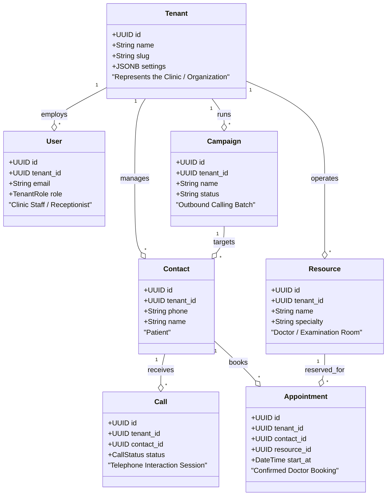

- **Tenant (`tenants` table)**: An isolated business entity (e.g., *Apex Heart & Dental Clinic*). Every piece of customer data, doctor configuration, and call history belongs strictly to one tenant.
- **User (`users` table)**: An authenticated human employee belonging to a tenant (e.g., *Dr. Rajesh Mehta* as Admin, *Pooja Sharma* as Operator).
- **Contact / Patient (`contacts` table)**: An external person to be contacted. In healthcare, a Contact is a patient with a verified phone number, name, language preference, and health record identifier.
- **Resource (`resources` table)**: A bookable physical or professional entity. In healthcare, this is a Doctor (e.g., *Dr. Sharma, Cardiologist*) or an equipment room (e.g., *MRI Scanner 1*). Resources have working hours, buffer times, and leave exceptions.
- **AI Agent**: A software persona configuration defining the voice timbre, speaking rate, base prompt, conversation stage controller, and allowed tool definitions.
- **Campaign (`campaigns` table)**: An operational workflow that schedules outbound calls to an assigned cohort of contacts using a specific AI agent, adhering to daily calling windows (e.g., 09:00 to 19:00) and retry strategies.
- **Call (`calls` table)**: A single telephone connection instance between the platform and a phone number, tracking duration, telephony provider SID, audio stream URL, transcript turns, and outcome classification.
- **Appointment (`appointments` table)**: A legally binding, confirmed time reservation tying a specific `Contact` (patient) to a `Resource` (doctor) at an exact timestamp (`start_at` to `end_at`). It is guarded by strict transactional concurrency to prevent double-booking.

---

# Section 2 — High-Level System Architecture

The platform follows a **Modular Monolith** architectural paradigm. Rather than splitting the early codebase into dozens of distributed microservices—which introduces complex network latency, distributed transaction failures, and operational maintenance overhead—all domain boundaries reside within a single high-performance Python application (`voice-ai-agent/backend/app`), complemented by a decoupled React frontend (`voice-ai-agent/frontend`) and an asynchronous Redis task worker (`voice-ai-agent/backend/app/workers`).

### System Architecture Diagram

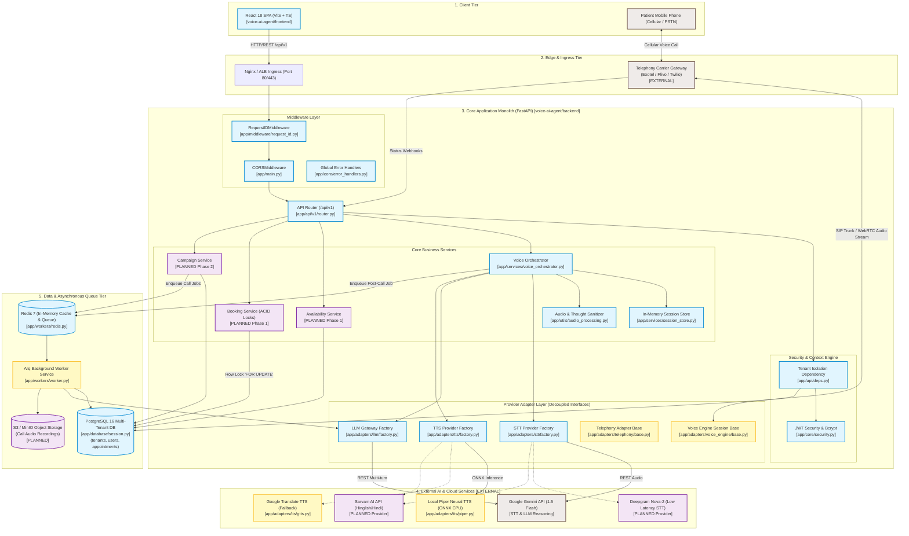

### Component Status Classification

| Component | Status | Codebase Location | Description |
|---|---|---|---|
| **FastAPI Core & Router** | **Verified / Implemented** | `backend/app/main.py`, `app/api/v1/router.py` | Asynchronous ASGI app factory with lifespan hooks, CORS, and `/api/v1` routes. |
| **Request ID Middleware** | **Verified / Implemented** | `backend/app/middleware/request_id.py` | Injects `X-Request-ID` into every HTTP transaction for end-to-end tracing. |
| **Error Handling Engine** | **Verified / Implemented** | `backend/app/core/error_handlers.py`, `exceptions.py` | Translates domain exceptions into structured JSON error envelopes. |
| **Security Foundation** | **Verified / Implemented** | `backend/app/core/security.py` | Standalone bcrypt password hashing and JWT encoding/decoding. |
| **Tenant Isolation Guard** | **Verified / Implemented** | `backend/app/api/deps.py` | Enforces tenant validation via JWT claims and optional `X-Tenant-ID` cross-check. |
| **PostgreSQL 16 & SQLAlchemy** | **Verified / Implemented** | `backend/app/database/base.py`, `session.py` | Asyncpg connection pool, Declarative Base, UUIDv4 PKs, and timestamp mixins. |
| **Alembic Initial Migration** | **Verified / Implemented** | `backend/migrations/versions/0001_initial...` | Migrates `tenants` and `users` tables with foreign keys and unique constraints. |
| **Voice Turn Orchestrator** | **Verified / Implemented** | `backend/app/services/voice_orchestrator.py` | Coordinates STT $\rightarrow$ LLM $\rightarrow$ TTS turn lifecycle with millisecond profiling. |
| **Audio Processing Utilities** | **Verified / Implemented** | `backend/app/utils/audio_processing.py` | Sentence chunking, tag scrubber, and TTS text sanitizer. |
| **Google STT Adapter** | **Verified / Implemented** | `backend/app/adapters/stt/google.py` | Gemini multimodal REST audio transcription with Hindi/English support. |
| **Google Gemini LLM Adapter** | **Verified / Implemented** | `backend/app/adapters/llm/gemini.py` | Multi-turn conversational LLM gateway with role mapping and system instruction. |
| **Piper Local TTS Adapter** | **Partially Implemented** | `backend/app/adapters/tts/piper.py` | CPU-based ONNX neural speech synthesis (~50-150ms). Python package or CLI binary needed. |
| **Telephony Adapter Interface**| **Partially Implemented** | `backend/app/adapters/telephony/base.py` | ABC and `MockTelephonyAdapter` exist; carrier implementations (Exotel/Plivo) planned. |
| **Voice Engine Session** | **Partially Implemented** | `backend/app/adapters/voice_engine/base.py` | Abstract interface for WebRTC/WebSocket runtime; LiveKit/Pipecat runtime planned. |
| **Arq Redis Task Worker** | **Partially Implemented** | `backend/app/workers/redis.py`, `worker.py` | Redis connection pool and worker config active; only sample `ping_job` registered. |
| **React Voice Playground** | **Verified / Implemented** | `frontend/src/features/voice-playground/` | Browser audio recording, audio playback, latency metrics, and session reset. |
| **Scheduling Core & DB** | **PLANNED (Phase 1 Priority)**| `backend/app/models/` (contacts, appointments)| Availability engine and transactional booking service with concurrency locks. |
| **Campaign & CSV Import Engine**| **PLANNED (Phase 2)** | `backend/app/services/campaign_service.py` | Patient CSV parsing, queue scheduling, retry rules, and dialer worker. |
| **Object Audio Storage** | **PLANNED** | S3 / MinIO Adapter | Cloud storage for dual-channel call recording WAV files and signed URL access. |

---

# Section 3 — User Login and Authentication Flow

Authentication secures the application so only verified employees can access their clinic's records.

### 3.1 Step-by-Step Authentication Journey

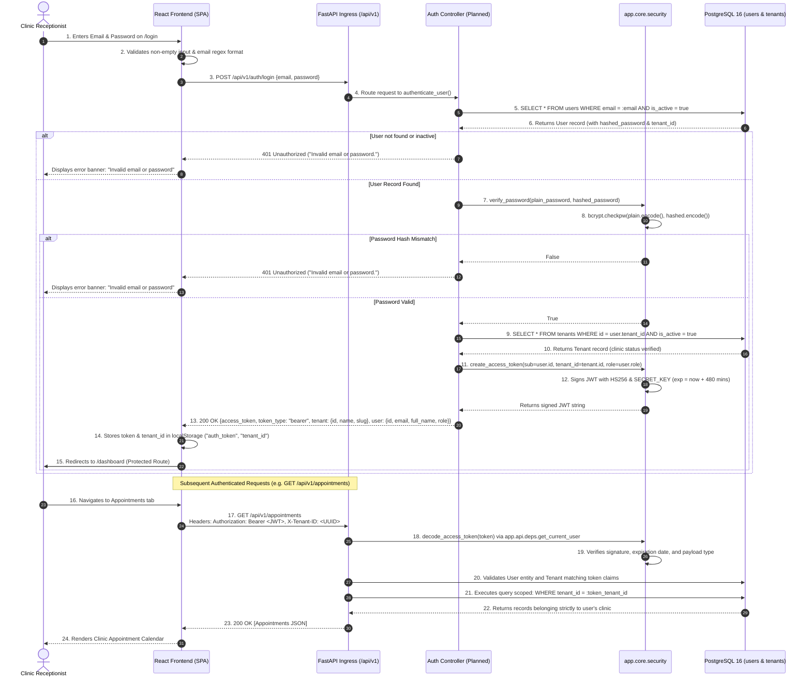

### 3.2 Data Payloads and Security Mechanisms

#### 1. Login Request Payload (`POST /api/v1/auth/login` - Planned Schema):
```json
{
  "email": "receptionist@apexclinic.com",
  "password": "SuperSecretPassword123!"
}
```

#### 2. Backend Password Verification (`app/core/security.py`):
Password hashing uses `bcrypt` directly with 12 rounds of salt generation. When verifying:
```python
def verify_password(plain_password: str, hashed_password: str) -> bool:
    try:
        return bcrypt.checkpw(
            plain_password.encode("utf-8"),
            hashed_password.encode("utf-8"),
        )
    except Exception:
        return False
```
This protects against timing attacks and ensures that raw passwords are never logged or stored in plain text.

#### 3. Successful Login Response Payload:
```json
{
  "access_token": "eyJhbGciOiJIUzI1NiIsInR5cCI6IkpXVCJ9...",
  "token_type": "bearer",
  "expires_in": 28800,
  "user": {
    "id": "c3b9b4f2-98e1-4c47-920f-02d9bb93051a",
    "email": "receptionist@apexclinic.com",
    "full_name": "Pooja Sharma",
    "role": "operator"
  },
  "tenant": {
    "id": "7f1b2c4e-1234-4a5b-bcde-998877665544",
    "name": "Apex Heart & Dental Clinic",
    "slug": "apex-clinic"
  }
}
```

#### 4. Decoded JWT Token Payload Structure:
```json
{
  "sub": "c3b9b4f2-98e1-4c47-920f-02d9bb93051a",
  "tenant_id": "7f1b2c4e-1234-4a5b-bcde-998877665544",
  "role": "operator",
  "type": "access",
  "iat": 1731900000,
  "exp": 1731928800
}
```

### 3.3 Token Expiration, Logout, and Current vs. Target Reality

- **Token Expiration**: The JWT expires after 480 minutes (configured via `settings.ACCESS_TOKEN_EXPIRE_MINUTES`). When an expired token reaches `app/core/security.py`, `jwt.decode` raises `jwt.ExpiredSignatureError`. The backend catches this and throws `UnauthorizedException("Token has expired.")`, returning HTTP 401. The frontend's `api-client.ts` catches HTTP 401, clears `localStorage`, and redirects the user back to `/login`.
- **Logout**: Logout is handled on the client side by clearing the stored credentials (`localStorage.removeItem("auth_token"); localStorage.removeItem("tenant_id");`). In Phase 2, a Redis token denylist can be added to support immediate server-side revocation before expiration.
- **Architectural Discrepancy Note**:
  - **Implemented**: `app/core/security.py` has full functions for bcrypt hashing, verification, token encoding, and decoding. `app/api/deps.py` has full dependency injection functions (`get_current_user`, `get_current_tenant`) that decode tokens and query the database.
  - **Missing**: The explicit HTTP endpoint `POST /api/v1/auth/login` is not yet hooked up in `app/api/v1/router.py`. Currently, the frontend routes straight to `HomePage.tsx` and `VoicePlayground.tsx` without an active login form.

---

# Section 4 — Tenant and Business Data Flow

Multi-tenancy guarantees that Clinic A (*Apex Heart Clinic*) and Clinic B (*Sunrise Dental Care*) can share the exact same application code, server, and PostgreSQL database instance without any possibility of Clinic A viewing Clinic B’s patients, doctors, or call recordings.

### 4.1 Multi-Tenant Data Isolation Pattern

The platform implements the **Shared Database, Shared Schema with Discriminator Column (`tenant_id`)** pattern (formalized in Architectural Decision Record **ADR 0002**):

1. **Discriminator Column**: Every single business table (`users`, `contacts`, `resources`, `campaigns`, `calls`, `appointments`) contains a mandatory foreign key:
   ```sql
   tenant_id UUID REFERENCES tenants(id) ON DELETE CASCADE
   ```
2. **Indexed Isolation**: An index is placed on `tenant_id` across every table, ensuring that queries filtered by `tenant_id` execute in logarithmic time ($O(\log N)$) using B-tree index scans.
3. **Application Layer Enforcement**: The tenant identifier is extracted cryptographically from the user’s authenticated JWT token (`sub`, `tenant_id`). It is impossible for a user to spoof their `tenant_id` in request parameters because the backend overrides any user-supplied tenant ID with the token's authenticated claim.

### 4.2 Concrete Example: Two Competing Clinics

Consider two healthcare organizations operating on the platform:
- **Tenant A**: *Apex Heart & Dental Clinic* (`tenant_id = 11111111-1111-1111-1111-111111111111`)
- **Tenant B**: *City Care Hospital* (`tenant_id = 22222222-2222-2222-2222-222222222222`)

```
                               PostgreSQL 16 Database
 ┌────────────────────────────────────────────────────────────────────────────────┐
 │ Table: contacts (Patients)                                                     │
 ├──────────────────────────────────────┬──────────────────────┬──────────────────┤
 │ id (UUID)                            │ tenant_id (UUID)     │ full_name        │
 ├──────────────────────────────────────┼──────────────────────┼──────────────────┤
 │ a1b2... (Patient 1)                  │ 11111111-... (Apex)  │ Ramesh Gupta     │
 │ a3b4... (Patient 2)                  │ 11111111-... (Apex)  │ Sunita Rao       │
 │ b5c6... (Patient 3)                  │ 22222222-... (City)  │ Dr. Amit Verma   │
 └──────────────────────────────────────┴──────────────────────┴──────────────────┘
```

#### How the Backend Prevents Data Leakage:
When Dr. Sharma from *Apex Heart Clinic* requests the patient list:
1. The frontend sends:
   ```http
   GET /api/v1/contacts HTTP/1.1
   Host: api.voiceplatform.com
   Authorization: Bearer <Apex_JWT_Token>
   X-Tenant-ID: 11111111-1111-1111-1111-111111111111
   ```
2. The FastAPI endpoint executes the dependency `get_current_tenant` (`app/api/deps.py`):
   ```python
   # In app/api/deps.py:
   if current_user:
       tenant_id = current_user.tenant_id
       if x_tenant_id:
           requested_id = uuid.UUID(x_tenant_id)
           if requested_id != tenant_id:
               raise ForbiddenException("Cross-tenant access is strictly prohibited.")
   ```
3. If Dr. Sharma manually alters the header to `X-Tenant-ID: 22222222-2222-2222-2222-222222222222` to peek at City Care Hospital's records, `requested_id != tenant_id` triggers, immediately halting execution and throwing:
   ```json
   {
     "success": false,
     "error": {
       "code": "FORBIDDEN",
       "message": "Cross-tenant access is strictly prohibited."
     }
   }
   ```
4. When legitimate, the repository service constructs an explicit SQLAlchemy query:
   ```python
   query = select(Contact).where(
       Contact.tenant_id == current_tenant.id,
       Contact.is_active == True
   )
   ```
   PostgreSQL executes the query against the B-tree index on `contacts.tenant_id`, returning only Ramesh Gupta and Sunita Rao. City Care Hospital’s patients are invisible to Apex Heart Clinic.

### 4.3 Current Code Enforcement vs. Planned State
- **Currently Enforced in Code**:
  - `app/models/tenant.py` and `app/models/user.py` contain the relational foreign key structure and cascade deletion rules.
  - `app/api/deps.py` contains the exact header-versus-token cross-check logic shown above.
- **Planned for Phase 1 / Phase 2**:
  - The tables for `contacts`, `resources`, `campaigns`, and `appointments` must inherit from a common `TenantScopedModel` or explicitly define `tenant_id` columns to maintain this guarantee.

---

# Section 5 — Contact / Patient Import and Management Flow

A clinic launches campaigns by importing patient contact lists. This section traces the planned end-to-end journey when a clinic receptionist uploads a CSV spreadsheet.

### 5.1 Step-by-Step CSV Import Journey

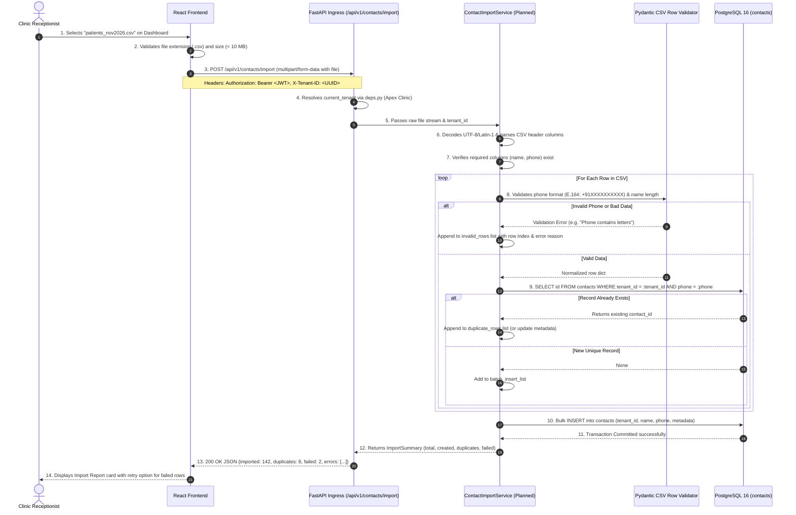

### 5.2 Input and Validation Rules
1. **Phone Number Sanitization**:
   - Indian mobile numbers come in various formats: `9876543210`, `09876543210`, `+91 98765 43210`.
   - The validation service strips spaces, hyphens, and leading zeros, normalizing to international E.164 format: `+919876543210`.
2. **Deduplication Logic**:
   - Deduplication is scoped strictly to the tenant (`tenant_id, phone`).
   - If Patient A is already registered at Apex Clinic, uploading them again flags them as a duplicate, preventing redundant outbound calls while optionally updating their metadata.
3. **Response Schema**:
```json
{
  "total_rows": 150,
  "successful_imports": 142,
  "duplicate_count": 6,
  "failed_count": 2,
  "errors": [
    {"row": 14, "phone": "12345", "reason": "Invalid Indian mobile number (must be 10 digits)."},
    {"row": 89, "phone": "+919876543210", "reason": "Missing patient name."}
  ]
}
```

---

# Section 6 — Campaign Creation and Execution Flow

A campaign represents a structured outbound calling initiative—for example, calling 500 hypertensive patients to schedule their quarterly doctor follow-up.

### 6.1 Campaign Lifecycle States
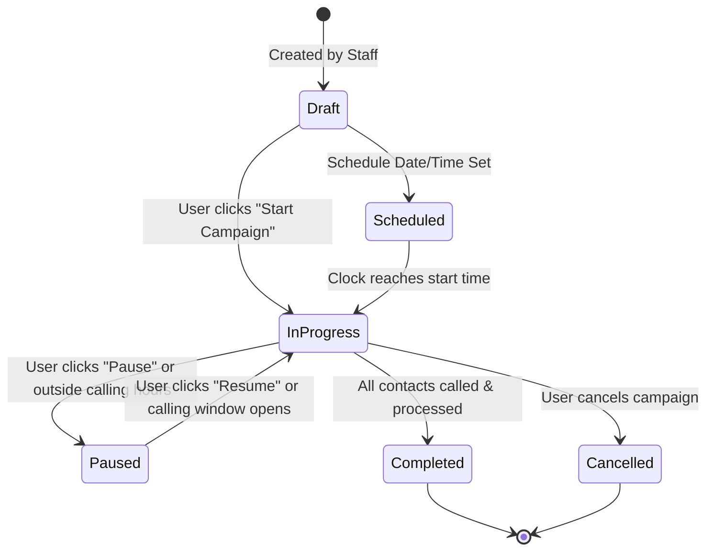

### 6.2 Campaign Execution Architecture
When a clinic user starts a campaign, the platform orchestrates between the relational database, Redis queue, and telephony dialers:

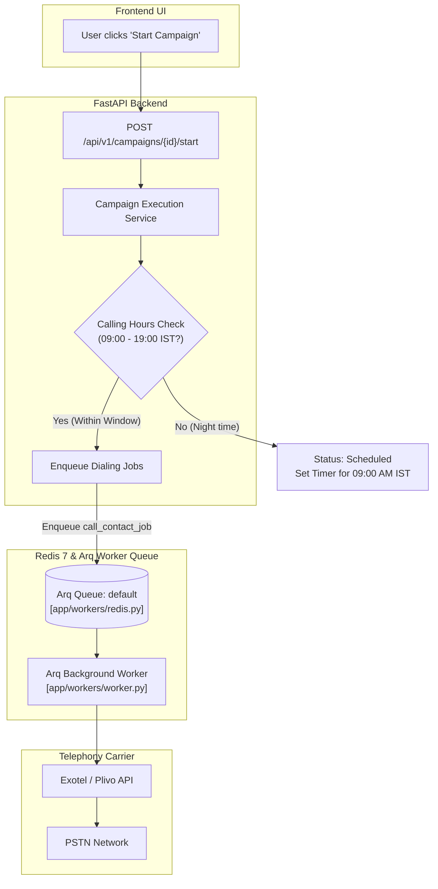

### 6.3 Call Selection, Deduplication, and Calling Rules
1. **Calling Hours Enforcement**: In compliance with Indian telecom regulations (TRAI), automated outbound commercial and informational calls may only occur between **09:00 AM and 07:00 PM local time (IST)**. The campaign engine checks the tenant's local timezone before popping jobs from the queue.
2. **Do-Not-Call (DNC) Registry Check**: Before initiating any call, the system queries the tenant’s `do_not_call` table. If the patient requested an opt-out during a previous call, the record is flagged `SKIPPED_DNC` and never dialed.
3. **Concurrency Throttling**: The dialer respects carrier limits (e.g., maximum 5 simultaneous active calls per clinic SIP trunk) to prevent carrier throttling or dropped lines.
4. **Retry Strategy**:
   - If a call status returns `BUSY` or `NO_ANSWER`, the job enqueues a retry with exponential backoff (e.g., Retry 1 after 30 minutes, Retry 2 after 3 hours, max 3 attempts).
   - If a call status returns `COMPLETED` or `NUMBER_INVALID`, no further calls are dispatched.

---

# Section 7 — Complete Voice Conversation Flow

This is the technical centerpiece of the platform. It details how audio moves from the telephone line through the AI speech-to-text pipeline, into the LLM reasoning loop with strict healthcare tools, and back out through neural text-to-speech synthesis.

## 7.1 Outbound Call Initiation

When a dialing job executes:
1. The background worker calls `TelephonyProvider.initiate_call()` (`app/adapters/telephony/base.py`).
2. The adapter issues a REST request to the carrier (e.g., Exotel or Plivo) with:
   - `from_number`: The clinic’s verified virtual outbound phone number.
   - `to_number`: The patient's mobile number.
   - `stream_webhook_url`: The WebSocket URL hosted by the voice engine to receive live audio packets once the call is answered.
3. The carrier dials the patient. When the patient picks up the phone:
   - Carrier sends an HTTP webhook `call.answered` to FastAPI.
   - Carrier opens a full-duplex bi-directional audio media stream over WebSocket.

---

## 7.2 Audio Input and Speech-to-Text (STT)

### Telephony Streaming Audio vs. Browser Voice Playground

It is critical to distinguish between the **Browser Voice Playground** (currently working in the codebase) and the **Telephony Carrier Streaming Pipeline** (target production architecture):

| Feature | Browser Voice Playground (Current) | Production Telephony Pipeline (Target) |
|---|---|---|
| **Audio Source** | Laptop Microphone via HTML5 `MediaRecorder` API | Cellular/PSTN telephone line via Telephony Carrier SIP/WebRTC |
| **Audio Format** | 48kHz / 44.1kHz Opus-encoded WebM / WAV | 8kHz 8-bit mono G.711 $\mu$-law or A-law PCM audio |
| **Transport** | HTTP POST multipart/form-data upload (`/api/v1/voice/turn`) | Full-duplex WebSocket stream (`ws://.../stream`) with continuous frames |
| **Turn Detection** | Manual: User presses "Start" and "Stop Recording" buttons | Automatic: Real-Time Voice Activity Detection (VAD) (Silero VAD) |
| **Turn Processing**| Batch turn: Single audio file uploaded, processed end-to-end | Streaming pipeline: Continuous audio chunks streamed in 20-50ms buffers |
| **Playback** | HTML5 `<audio>` tag playing base64-decoded WAV in browser | Real-time byte buffer streaming over WebSocket back to telephone handset |

### How Speech-to-Text (STT) Works
1. **Audio Ingestion**: In the current implementation (`app/api/v1/voice.py`), raw audio bytes arrive in the `process_voice_turn` endpoint.
2. **Audio Validation**: The payload is verified to be larger than 50 bytes and within the 15 MB limit.
3. **MIME Normalization**: `GoogleSTTAdapter._normalize_mime` (`app/adapters/stt/google.py`) cleans codecs like `audio/webm;codecs=opus` down to `audio/webm`.
4. **Transcription Execution**: The adapter base64-encodes the audio and posts an inline data payload to Google Gemini’s `generateContent` endpoint:
   ```json
   {
     "contents": [{
       "role": "user",
       "parts": [
         {"text": "Transcribe the audio verbatim. Output ONLY the exact transcribed speech in the original spoken language (Hindi, English, or Hinglish)..."},
         {"inlineData": {"mimeType": "audio/webm", "data": "<BASE64_DATA>"}}
       ]
     }]
   }
   ```
5. **Language Code-Switching**: Gemini recognizes Hindi script, Latin English, and colloquial Hinglish (e.g., *"Mujhe kal Dr. Sharma ke saath appointment chahiye"*). It returns the verbatim transcription string.

---

## 7.3 LLM Processing and Conversational Guardrails

Once transcribed, text enters `VoiceOrchestrator.execute_turn` (`app/services/voice_orchestrator.py`).

### Context Assembly and System Prompting
The assistant maintains session context through `InMemorySessionStore` (`app/services/session_store.py`). The prompt enforces conversational brevity and strict healthcare guardrails:

```
[SYSTEM PROMPT]
You are a friendly, natural, and helpful AI voice assistant calling from Apex Heart & Dental Clinic.
Respond in plain, spoken conversational language suitable for a phone call.
Keep responses concise (1 to 3 sentences maximum).
Never use markdown formatting, bolding, bullet points, asterisks, or emojis.
If the user speaks Hindi or Hinglish, respond naturally in Hinglish or Hindi.

HEALTHCARE SAFETY CONSTRAINTS:
1. You are NOT a doctor. NEVER provide medical advice, diagnosis, or medication recommendations.
2. If the user mentions severe chest pain, breathing difficulties, profuse bleeding, or an emergency, IMMEDIATELY instruct them to hang up and call 112 or visit the nearest emergency room.
3. NEVER disclose medical details or appointment history before verifying the patient's identity.
```

### Conversational Stage Controller Logic
In conversational healthcare, an LLM must not be allowed to jump directly to booking without verifying the patient's identity:

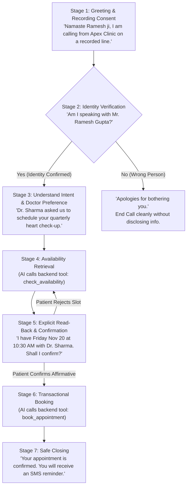

### Why the LLM Never Touches the Database Directly
The LLM does **not** have direct SQL credentials. Allowing an LLM to generate raw SQL opens the application to SQL injection, accidental deletions, and catastrophic hallucinations (e.g., the LLM inventing non-existent appointment slots).

Instead, the LLM utilizes **Function Calling / Tool Use**:
1. The backend provides the LLM with typed function schemas: `check_availability(resource_name, date)` and `book_appointment(resource_id, contact_id, slot_timestamp)`.
2. When the LLM decides to check a schedule, it outputs a structured JSON function call.
3. The backend executes the function with validated application code and returns the verified database result back to the LLM.

---

## 7.4 Appointment Availability Checking and Double-Booking Prevention

### The Race Condition Problem: Concurrent Double-Booking
Imagine Patient A and Patient B are simultaneously on the phone with two different AI voice channels at 10:00 AM. Both patients ask for Dr. Sharma's only remaining open slot on Friday at 10:30 AM.

If the application uses naive database queries:
1. Channel A queries: *Is 10:30 AM open?* DB says: *Yes*.
2. Channel B queries: *Is 10:30 AM open?* DB says: *Yes*.
3. Channel A inserts: *Booked for Patient A*.
4. Channel B inserts: *Booked for Patient B*.
**Result: Disaster.** Two patients show up at Dr. Sharma’s clinic for the same 30-minute slot.

### The Solution: Database Constraints and Row-Level Locking

The platform prevents this using a two-layer transactional defense:

#### Layer 1: PostgreSQL Partial Unique Index
```sql
CREATE UNIQUE INDEX uq_appointments_active_resource_slot 
ON appointments (tenant_id, resource_id, start_at) 
WHERE status NOT IN ('cancelled', 'rescheduled');
```
If two database queries attempt to insert the same `(tenant_id, resource_id, start_at)`, the database engine itself rejects the second transaction with a `UniqueViolation` error at the hardware storage level.

#### Layer 2: ACID Transaction with Row-Level Locking (`SELECT ... FOR UPDATE`)
```python
async def book_appointment_transactional(
    db: AsyncSession,
    tenant_id: uuid.UUID,
    contact_id: uuid.UUID,
    resource_id: uuid.UUID,
    start_at: datetime,
    end_at: datetime,
) -> Appointment:
    async with db.begin():  # Begins ACID transaction
        # 1. Acquire an exclusive row-level lock on the Doctor's resource record
        result = await db.execute(
            select(Resource)
            .where(Resource.id == resource_id, Resource.tenant_id == tenant_id)
            .with_for_update()  # Locks the row! Other transactions must wait
        )
        resource = result.scalar_one_or_none()
        if not resource:
            raise NotFoundException("Doctor resource not found.")

        # 2. Check if an active appointment already occupies this slot
        existing = await db.execute(
            select(Appointment).where(
                Appointment.tenant_id == tenant_id,
                Appointment.resource_id == resource_id,
                Appointment.start_at == start_at,
                Appointment.status.not_in(["cancelled", "rescheduled"]),
            )
        )
        if existing.scalar_one_or_none():
            raise ConflictException("This time slot was just taken by another patient.")

        # 3. Insert the new booking
        appointment = Appointment(
            tenant_id=tenant_id,
            contact_id=contact_id,
            resource_id=resource_id,
            start_at=start_at,
            end_at=end_at,
            status="booked",
        )
        db.add(appointment)
        await db.commit()  # Atomically releases lock and commits
        return appointment
```

### Complete End-to-End Concrete Dialogue Trace

```
1. Caller: "Namaste, I want to book an appointment with Dr. Sharma tomorrow."
2. STT Engine: Transcribes audio -> "Namaste, I want to book an appointment with Dr. Sharma tomorrow."
3. LLM Gateway: Recognizes intent: Booking. Missing: Preferred time.
4. LLM Action: Emits Tool Call -> check_availability(doctor="Dr. Sharma", date="2026-11-19")
5. Backend Service: 
   - Queries Dr. Sharma's working hours for Thursday (09:00 - 13:00, 30 min slots).
   - Subtracts existing bookings.
   - Returns open slots: ["10:00 AM", "11:30 AM"].
6. LLM Generates Response: "Dr. Sharma has openings tomorrow at 10:00 AM and 11:30 AM. Which one works best for you?"
7. TTS Engine: Synthesizes Hindi/English speech and streams audio to caller.
8. Caller: "10:00 AM will be perfect."
9. STT Engine: Transcribes -> "10:00 AM will be perfect."
10. LLM Action (MANDATORY READ-BACK STAGE): 
    "Just to confirm, I am booking an appointment for you with Dr. Sharma tomorrow, Thursday Nov 19th at 10:00 AM. Should I go ahead and book this?"
11. Caller: "Yes, please confirm."
12. LLM Action: Emits Tool Call -> book_appointment(doctor_id="...", slot="2026-11-19T10:00:00+05:30")
13. Backend Service: Executes ACID transaction with 'with_for_update()'. Lock acquired, unique slot confirmed, appointment row created.
14. LLM Response: "Your appointment with Dr. Sharma is confirmed for tomorrow at 10:00 AM. We have sent a confirmation SMS to your phone. Thank you and take care!"
15. TTS Engine: Plays confirmation. Voice Orchestrator ends call.
```

---

## 7.5 Text-to-Speech (TTS) and Spoken Response Delivery

Once the LLM generates a response string, the text must be converted into high-fidelity spoken audio.

### 1. Spoken Text Sanitization (`app/utils/audio_processing.py`)
Neural TTS models will literally read out markdown syntax if not sanitized (e.g., speaking *"asterisk asterisk bold asterisk asterisk"* or attempting to pronounce emoji codes). `sanitize_text_for_tts()` strips:
- Markdown characters (`*`, `#`, `_`, `~`, `` ` ``)
- HTTP/HTTPS URLs
- Emojis and unicode symbols
- Thought tags (`<thought>...</thought>`)

### 2. Neural Audio Synthesis via Piper (`app/adapters/tts/piper.py`)
The platform integrates **Piper TTS**, an ultra-fast local neural text-to-speech engine running on ONNX Runtime:
- **Speed**: Generates audio in **50 to 150 milliseconds** on a standard CPU, completely avoiding third-party cloud API costs and network latency.
- **Voices**:
  - English: `en_US-lessac-medium` (Natural, clear female voice)
  - Hindi: `hi_IN-pratham-medium` (Crisp, professional Indian male voice)
  - Hindi: `hi_IN-priyamvada-medium` (Professional Indian female voice)
- **Fallback Adapter**: If Piper is not installed on the host system, the adapter gracefully falls back to `gTTS` (`app/adapters/tts/gtts.py`) or returns a valid silent WAV stream from `MockTTSAdapter` (`app/adapters/tts/base.py`) so tests never crash.

### 3. Response Delivery
- In the **Voice Playground**, synthesized audio is base64-encoded and returned in the HTTP JSON response (`VoiceTurnResponse`). The frontend's `AudioPlayer.tsx` decodes it into a `data:audio/wav;base64,...` URI and plays it automatically via HTML5 Audio.
- In **Telephony Mode**, synthesized PCM chunks are queued directly into the carrier’s RTP/WebSocket media stream.

---

# Section 8 — Call Completion and Post-Call Processing

When a phone call concludes (either through a polite goodbye, patient hang-up, or network disconnection), the system transitions from synchronous real-time streaming to asynchronous background processing.

### 8.1 Synchronous vs. Asynchronous Lifecycle Separation

```
During the Call (Synchronous - Low Latency < 1.0s):
  Caller Speech ──> VAD ──> STT ──> LLM ──> TTS ──> Handset Audio

After the Call (Asynchronous - Offloaded to Redis / Arq Worker):
  Call Ended Event ──> Store Transcript ──> LLM Call Summary ──> Extract Structured Outcome ──> Send SMS
```

### 8.2 Step-by-Step Post-Call Processing Journey

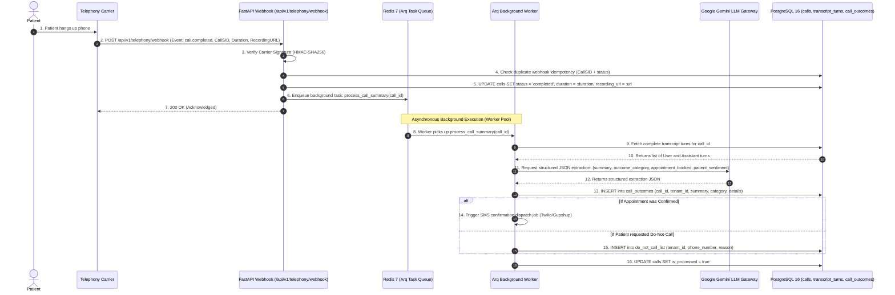

### 8.3 Structured Outcome Classifications
Every completed call is classified by the LLM into one of several standardized business dispositions:
1. `APPOINTMENT_CONFIRMED`: Patient agreed to and finalized a doctor booking.
2. `CALLBACK_REQUESTED`: Patient requested a call at another time (stores `callback_datetime`).
3. `DECLINED_CARE`: Patient stated they no longer require medical consultation.
4. `WRONG_NUMBER`: The person answering was not the intended patient.
5. `DO_NOT_CALL`: Patient explicitly demanded to be removed from future outreach.
6. `EMERGENCY_ESCALATION`: Patient mentioned life-threatening symptoms; emergency redirection was triggered.
7. `VOICEMAIL_DETECTED`: Call answered by automated answering machine; safe non-PHI message left.

---

# Section 9 — Database Architecture and Data Model

### 9.1 Actual Existing Database Schema (Current Repository State)

The repository currently contains **Alembic Migration `0001_initial_tenants_and_users.py`** defining two core tables:

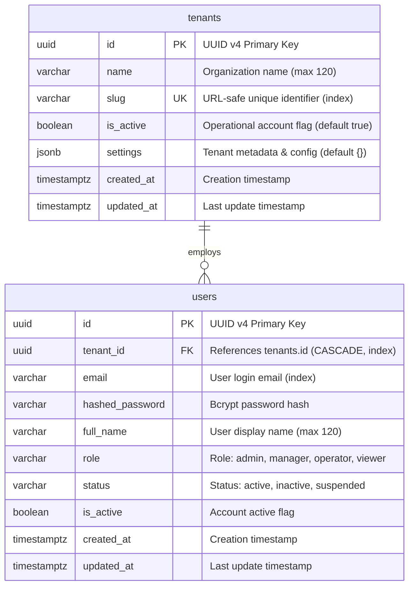

#### Constraints in Current Models:
- **`tenants` table**:
  - Primary Key: `id` (UUIDv4)
  - Unique Index: `slug` (`ix_tenants_slug`)
- **`users` table**:
  - Primary Key: `id` (UUIDv4)
  - Foreign Key: `tenant_id` $\rightarrow$ `tenants.id` with `ondelete="CASCADE"`
  - Composite Unique Constraint: `uq_users_tenant_email` on `(tenant_id, email)` (allows an individual email to exist across separate tenant accounts while enforcing uniqueness within a tenant).
  - Indexes: `ix_users_id`, `ix_users_tenant_id`, `ix_users_email`.

---

### 9.2 Complete Target Architecture Schema (Phase 1 & Phase 2)

To satisfy the full product requirements for healthcare appointment scheduling, campaigns, and call analytics, the schema must be extended with the following tables:

```mermaid
erDiagram
    tenants ||--o{ users : "employs"
    tenants ||--o{ contacts : "manages"
    tenants ||--o{ resources : "operates"
    tenants ||--o{ campaigns : "runs"
    tenants ||--o{ calls : "owns"
    tenants ||--o{ appointments : "books"
    tenants ||--o{ do_not_call : "enforces"

    resources ||--o{ availability_rules : "defines"
    resources ||--o{ availability_exceptions : "schedules"
    resources ||--o{ appointments : "reserved_for"

    contacts ||--o{ appointments : "booked_by"
    contacts ||--o{ campaign_contacts : "targeted_in"
    contacts ||--o{ calls : "recipient_of"

    campaigns ||--o{ campaign_contacts : "contains"
    campaigns ||--o{ calls : "generates"

    calls ||--o{ transcript_turns : "records"
    calls ||--o| call_outcomes : "evaluates"

    contacts {
        uuid id PK
        uuid tenant_id FK
        varchar phone
        varchar full_name
        jsonb metadata
        timestamptz created_at
    }

    resources {
        uuid id PK
        uuid tenant_id FK
        varchar name
        varchar specialty
        integer slot_duration_minutes
        boolean is_active
    }

    availability_rules {
        uuid id PK
        uuid resource_id FK
        integer day_of_week
        time start_time
        time end_time
    }

    availability_exceptions {
        uuid id PK
        uuid resource_id FK
        timestamptz start_datetime
        timestamptz end_datetime
        varchar reason
    }

    appointments {
        uuid id PK
        uuid tenant_id FK
        uuid contact_id FK
        uuid resource_id FK
        timestamptz start_at
        timestamptz end_at
        varchar status
        timestamptz created_at
    }

    campaigns {
        uuid id PK
        uuid tenant_id FK
        varchar name
        varchar status
        time daily_start_time
        time daily_end_time
        integer max_retries
    }

    calls {
        uuid id PK
        uuid tenant_id FK
        uuid campaign_id FK
        uuid contact_id FK
        varchar telephony_call_sid
        varchar status
        integer duration_seconds
        varchar recording_url
        timestamptz initiated_at
    }

    transcript_turns {
        uuid id PK
        uuid call_id FK
        integer turn_number
        varchar speaker
        text message_text
        float latency_ms
    }

    call_outcomes {
        uuid id PK
        uuid call_id FK UK
        varchar category
        text summary
        jsonb structured_data
    }

    do_not_call {
        uuid id PK
        uuid tenant_id FK
        varchar phone UK
        varchar reason
        timestamptz created_at
    }
```

### 9.3 Data Placement Strategy: What Belongs Where?

| Storage Engine | Technology | Data Stored | Data NEVER Stored |
|---|---|---|---|
| **Relational Database** | PostgreSQL 16 | Structured entities, foreign keys, tenants, users, contacts, doctors, working hours, appointments, call logs, metadata, text transcripts. | Raw binary audio recordings, ephemeral streaming audio packets, raw vector embeddings. |
| **In-Memory Cache & Queue** | Redis 7 | Arq job queues, distributed locking keys (`redlock`), session turn buffers, rate-limiting tokens, telephony webhook deduplication cache. | Permanent financial records, historical appointment logs, user passwords. |
| **Object / Blob Storage** | AWS S3 / MinIO | Dual-channel call recording WAV/MP3 files, uploaded CSV batch files. | User credentials, relational metadata, live database backups in unencrypted form. |

### 9.4 Privacy & Sensitive Healthcare Data Considerations
1. **Protected Health Information (PHI)**: Transcripts and appointment records contain patient names, phone numbers, and clinical department visits. All database volumes must enforce AES-256 encryption-at-rest.
2. **Audio Retention Policies**: Clinics can configure audio retention windows in their `tenants.settings` (e.g., 30 days, 90 days, or 1 year). An automated nightly Arq background job purges audio files older than the retention threshold from S3 while preserving anonymized numerical metrics.
3. **Internal Chain-of-Thought**: LLM internal reasoning thoughts (`<thought>...</thought>`) generated by reasoning models are stripped in real-time by `StreamingThoughtScrubber` (`app/utils/audio_processing.py`) and are **never** persisted to the `transcript_turns` table.

---

# Section 10 — API Architecture & Endpoint Inventory

### 10.1 Implemented & Verified Endpoints

The following endpoints are currently implemented, registered in `app/api/v1/router.py`, and verified in the codebase:

| Method | Endpoint URL | Router File | Authentication | Tenant Guard | Purpose |
|---|---|---|---|---|---|
| `GET` | `/health` | `app/api/v1/health.py` | None | None | Deep health check probing PostgreSQL 16 and Redis 7 connectivity. |
| `GET` | `/api/v1/health` | `app/api/v1/health.py` | None | None | Versioned alias for container orchestration health checks. |
| `POST` | `/api/v1/voice/turn` | `app/api/v1/voice.py` | None (Playground) | Ephemeral Session | Ingests audio file, runs STT $\rightarrow$ LLM $\rightarrow$ TTS, returns base64 audio and timings. |
| `GET` | `/api/v1/voice/providers` | `app/api/v1/voice.py` | None (Playground) | None | Reports readiness of STT (Google), LLM (Gemini), and TTS (Piper/gTTS) providers. |
| `POST` | `/api/v1/voice/sessions/{id}/reset`| `app/api/v1/voice.py`| None (Playground)| Session ID | Clears conversational history for an active session ID. |

#### Detailed Specification: `POST /api/v1/voice/turn`
- **Request Form-Data**:
  - `audio`: Binary audio file (`UploadFile`), max 15 MB.
  - `session_id`: Optional string identifying the multi-turn session.
  - `language`: Spoken language hint (`"en"` or `"hi"`).
- **Backend Service**: `VoiceOrchestrator.execute_turn()` (`app/services/voice_orchestrator.py`).
- **Response Payload (`VoiceTurnResponse`)**:
```json
{
  "session_id": "sess-1731901234",
  "transcript": "I want to schedule an appointment with Dr. Sharma.",
  "response_text": "I can help with that. Dr. Sharma has openings tomorrow at 10:00 AM and 2:00 PM.",
  "audio_base64": "UklGRi4AAABXQVZFZm10IBAAAAABAAEA...",
  "audio_mime_type": "audio/wav",
  "audio_error": null,
  "timings": {
    "stt_ms": 342.5,
    "llm_ms": 481.2,
    "tts_ms": 112.0,
    "total_ms": 935.7
  },
  "providers": {
    "stt": "google",
    "llm": "gemini",
    "tts": "piper"
  }
}
```

---

### 10.2 Planned Endpoint Contracts (Phases 1 & 2)

#### Authentication & Organizations
- `POST /api/v1/auth/login`: Authenticate with email/password, return JWT token.
- `POST /api/v1/auth/refresh`: Refresh an expiring access token.
- `GET /api/v1/tenants/me`: Fetch current tenant details and operational settings.
- `PATCH /api/v1/tenants/me`: Update clinic calling hours, timezone, and phone number.

#### Contacts / Patients
- `GET /api/v1/contacts`: Paginated list of contacts for current tenant.
- `POST /api/v1/contacts`: Create an individual patient contact.
- `POST /api/v1/contacts/import`: Upload and process patient CSV file.

#### Healthcare Scheduling & Appointments
- `GET /api/v1/resources`: List doctors/resources for current tenant.
- `POST /api/v1/resources`: Register a new doctor with slot duration.
- `GET /api/v1/resources/{id}/availability`: Calculate open slots for a given date range.
- `POST /api/v1/appointments`: Book an appointment (guarded by ACID concurrency lock).
- `GET /api/v1/appointments`: Filter appointments by doctor, date, or patient.

#### Campaigns & Telephony
- `POST /api/v1/campaigns`: Create a new outbound calling campaign.
- `POST /api/v1/campaigns/{id}/start`: Launch campaign dialing worker.
- `POST /api/v1/campaigns/{id}/pause`: Pause campaign dialing worker.
- `POST /api/v1/telephony/webhook`: Carrier status webhook endpoint (requires HMAC verification).

---

# Section 11 — Redis & Background Job Architecture

### 11.1 Purpose of Redis
Redis 7 is deployed as an in-memory data store supporting:
1. **Asynchronous Task Queue (via Arq)**: Manages delayed and background jobs without blocking FastAPI’s async event loop.
2. **Distributed Locking (`Redlock`)**: Prevents race conditions when scheduling campaign batches across multiple server instances.
3. **Webhook Idempotency Cache**: Stores carrier event IDs for 24 hours to prevent duplicate processing of retried webhooks.
4. **Anti-Pattern Warning**: Redis is **never** used as a primary database for persistent entities (contacts, appointments, users). All durable business state resides in PostgreSQL.

### 11.2 Arq Worker Configuration (`app/workers/`)
- **Connection Pool (`app/workers/redis.py`)**: Uses `arq.create_pool()` with settings from `settings.REDIS_HOST` and `settings.REDIS_PORT`.
- **Worker Specification (`app/workers/worker.py`)**:
  ```python
  class WorkerSettings:
      functions = [ping_job, process_call_summary, dispatch_campaign_calls]
      redis_settings = get_redis_settings()
      max_jobs = 10
      job_timeout = 300  # 5 minutes
      keep_result = 3600  # 1 hour
  ```

### 11.3 Concrete Job Examples

#### 1. Campaign Batch Dispatcher Job:
```python
async def dispatch_campaign_calls(ctx: dict, campaign_id: str) -> None:
    # 1. Check if current time is within legal window (09:00 - 19:00)
    # 2. Query next 10 pending contacts for campaign
    # 3. For each contact, verify DNC status
    # 4. Trigger TelephonyProvider.initiate_call()
```

#### 2. Post-Call Summary and Structured Extraction Job:
```python
async def process_call_summary(ctx: dict, call_id: str) -> None:
    # 1. Fetch transcript from database
    # 2. Invoke LLM with extraction prompt
    # 3. Save structured outcome into call_outcomes table
    # 4. If booking made, enqueue SMS confirmation
```

---

# Section 12 — File and Audio Storage Architecture

### 12.1 Audio File Ingestion and Storage Pipeline

```mermaid
flowchart LR
    TelStream["Telephony Audio Stream<br/>(Dual-Channel PCM)"] --> CarrierRec["Carrier Recording Service"]
    CarrierRec -->|Post-Call Webhook| FastAPIServer["FastAPI Backend"]
    FastAPIServer -->|Enqueue Download Job| ArqQueue["Redis / Arq Queue"]
    ArqQueue --> Worker["Arq Background Worker"]
    Worker -->|Fetch Raw Audio| CarrierRec
    Worker -->|Upload Encrypted WAV| CloudStorage[("S3 / MinIO Object Storage<br/>bucket: clinic-call-recordings")]
    Worker -->|Write S3 Key Reference| PostgresDB[("PostgreSQL 16<br/>calls.recording_url")]
    
    StaffUser["Clinic Receptionist"] -->|View Call Details| ReactApp["React Dashboard"]
    ReactApp -->|GET /api/v1/calls/{id}/recording| FastAPIServer
    FastAPIServer -->|Generate Signed URL (expires 15m)| CloudStorage
    FastAPIServer -->> ReactApp| Pre-signed S3 URL |
    ReactApp -->|Direct Stream Audio| CloudStorage
```

### 12.2 Security and Access Control for Recordings
1. **Zero Public Access**: The S3/MinIO bucket is strictly private. All public access block settings are enabled.
2. **Pre-Signed URLs**: When a clinic user clicks "Play Recording" on their dashboard, the backend generates an Amazon S3 **Pre-Signed URL** with a 15-minute expiration window. The browser streams directly from object storage without routing large audio payloads through the FastAPI server.
3. **Tenant Prefixing**: Files are partitioned by tenant UUID:
   `s3://clinic-recordings/tenant_<tenant_id>/year=2026/month=11/<call_id>.wav`

---

# Section 13 — Error Handling and Failure Scenarios

A resilient production platform must handle failures gracefully. The table below specifies failure modes across all critical subsystems:

| Failure Scenario | Detecting Component | Backend Action | Retry Policy | User/Caller Experience | Call Continuity |
|---|---|---|---|---|---|
| **Database Offline** | `app/database/session.py` | Engine raises `OperationalError`. Global handler returns HTTP 503 (`DATABASE_UNAVAILABLE`). | Automatic pool reconnect every 5s. | Web user sees "Service Degraded" banner. | If active call is running, in-memory audio continues; booking fails with apology. |
| **Redis Offline** | `app/workers/redis.py` | Lifespan logs warning; Arq pool calls fail gracefully. | Reconnect attempted on next task submission. | Dashboard metrics load; background jobs pause until Redis recovers. | Active calls proceed normally; post-call summaries delayed in queue. |
| **STT Provider Times Out** | `GoogleSTTAdapter` | Catches timeout after 30s, raises `SpeechToTextError`. | 1 immediate retry; if still failing, trigger fallback STT. | Caller hears: *"I am sorry, I had trouble hearing that. Could you please repeat?"* | **Call Continues Safely.** |
| **LLM Provider Fails / Rate Limited** | `GeminiLLMAdapter` | Catches HTTP 429/500, raises `LLMGenerationError`. | Exponential backoff (1s, 2s, 4s) across 3 attempts. | Caller hears: *"One moment please, let me check that information for you."* | **Call Continues Safely.** |
| **TTS Provider Fails** | `PiperTTSAdapter` / `VoiceOrchestrator` | `execute_turn` catches TTS error; preserves transcript and LLM text! | Fallback to `gTTS` or cloud TTS provider. | In Voice Playground, text response is displayed even if audio generation fails. | In phone call, fallback TTS speaks response. |
| **Telephony Line Disconnected** | Telephony Carrier Gateway | Carrier sends `call.disconnected` webhook to FastAPI. | No retry if patient hung up; retry if carrier dropped line. | Call ends cleanly. | Call terminates; post-call worker processes partial transcript. |
| **Duplicate Webhook Received** | `app/api/v1/telephony.py` | Redis idempotency check (`SETNX webhook_id EX 86400`). | Discarded immediately; returns HTTP 200. | No effect; prevents duplicate background jobs. | N/A |
| **Concurrent Double-Booking Attempt** | `BookingService` (Postgres) | Unique index or row lock raises `ConflictException` / `UniqueViolation`. | No DB retry; business logic offers next available open slot. | AI Agent immediately says: *"That slot was just reserved. Would 11:30 AM work instead?"* | **Call Continues Safely.** |
| **Cross-Tenant Access Attempt** | `app/api/deps.py` (`get_current_tenant`)| Header `X-Tenant-ID` does not match token claim; raises `ForbiddenException`. | None; security violation logged. | HTTP 403 Forbidden returned to attacker. | Blocked completely. |

---

# Section 14 — Security, Privacy, and Multi-Tenant Isolation

### 14.1 Security Control Matrix

| Domain | Implemented Controls (In Repository) | Missing Controls (Planned) | Architectural Recommendation |
|---|---|---|---|
| **Password Storage** | Direct `bcrypt` with 12 salt rounds in `app/core/security.py`. | Password complexity regex validation on registration. | Enforce minimum 10 characters, mixed case, numbers, and symbols. |
| **Authentication** | HS256 JWT tokens with subject, tenant_id, role, and expiration. | Refresh token rotation and server-side revocation list. | Store revoked token JTI strings in Redis with TTL matching token expiry. |
| **Authorization (RBAC)**| Enum roles: `admin`, `manager`, `operator`, `viewer` (`models/enums.py`).| Endpoint permission decorators (`@require_role(TenantRole.ADMIN)`). | Implement reusable FastAPI dependency checking `current_user.role`. |
| **Tenant Isolation** | Foreign keys on `tenants`, JWT tenant claims, `deps.py` header verification. | Base repository class that auto-appends `.where(tenant_id=...)` to all queries. | Create `TenantScopedRepository` to make omitting `tenant_id` impossible. |
| **API Validation** | Pydantic v2 schemas across requests and responses. | Request rate-limiting middleware. | Deploy Redis token-bucket rate limiting (e.g., 60 req/min per IP). |
| **Webhook Security** | None currently implemented. | Telephony carrier HMAC-SHA256 signature verification. | Verify carrier header signatures before processing any webhook payload. |
| **Secrets Management** | `.env` loading via Pydantic Settings (`app/core/config.py`). | Cloud Secret Manager integration (AWS KMS / HashiCorp Vault). | Never commit `.env` to Git; inject secrets via container environment variables. |
| **Recording Consent** | Stated in system prompt guidelines. | Explicit conversational confirmation stage before proceeding. | Agent must say: *"This call is recorded for quality. Is that okay?"* |
| **Audio Access Control**| In-memory base64 encoding for Playground testing. | S3 Pre-Signed URLs with 15-minute expiration. | Never expose public S3 URLs; strictly use time-limited pre-signed links. |

---

# Section 15 — Complete End-to-End User Journeys (Sequence Diagrams)

### Journey 1: User Login and Dashboard Access
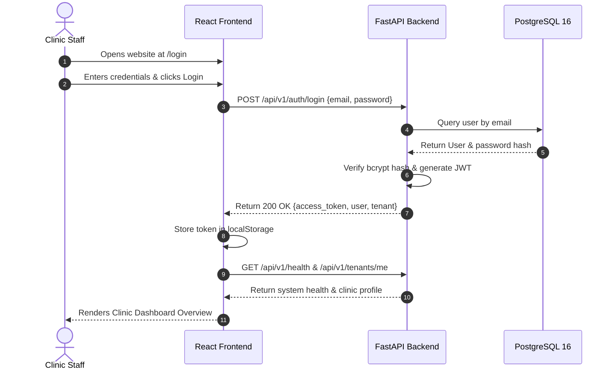

### Journey 2: Outbound Call with STT $\rightarrow$ LLM $\rightarrow$ TTS
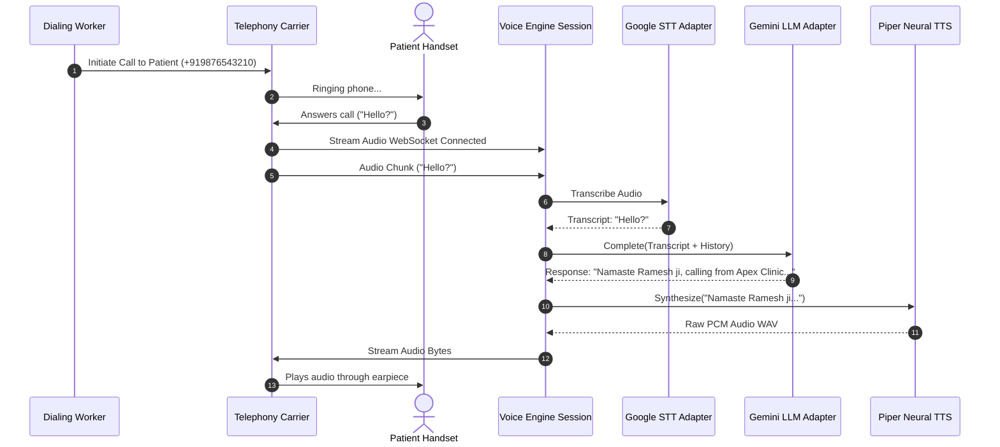

### Journey 3: Appointment Availability Checking and Booking
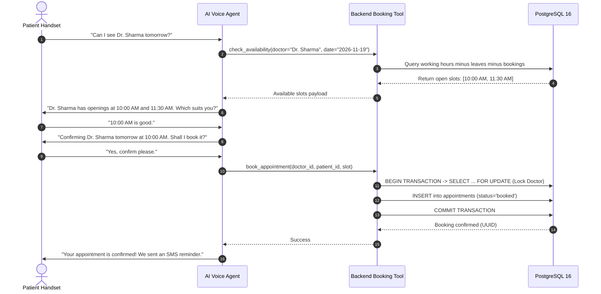

### Journey 4: Call Completion and Post-Call Analytics
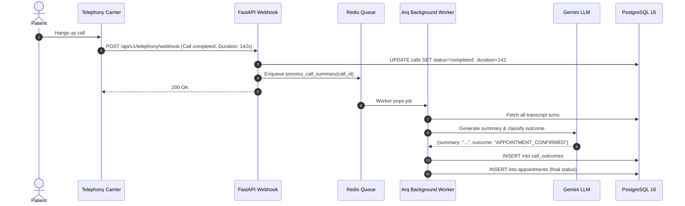

---

# Section 16 — Current Implementation vs. Target Architecture (Gap Analysis)

This objective audit maps every major component between what is actually present in the repository and what remains to be built:

| Subsystem | Component | Implementation Status | Evidence / Code References | Gap / Action Required |
|---|---|---|---|---|
| **Core Framework** | FastAPI App Factory | **Verified & Implemented** | `voice-ai-agent/backend/app/main.py` | None. Lifespan and routing fully active. |
| **Core Framework** | Configuration Settings | **Verified & Implemented** | `backend/app/core/config.py` | None. Pydantic v2 settings loading `.env`. |
| **Core Framework** | Error Handlers & Exceptions| **Verified & Implemented** | `backend/app/core/error_handlers.py`, `exceptions.py` | None. Clean domain exception hierarchy. |
| **Core Framework** | Request ID Middleware | **Verified & Implemented** | `backend/app/middleware/request_id.py` | None. Injects distributed tracing headers. |
| **Security** | Password & JWT Security | **Verified & Implemented** | `backend/app/core/security.py` | Auth router endpoint (`/auth/login`) must be added to expose functions via HTTP. |
| **Multi-Tenancy** | Dependency Injection Guard | **Verified & Implemented** | `backend/app/api/deps.py` (`get_current_tenant`) | Extend check to future scheduling and campaign tables. |
| **Database** | PostgreSQL Engine & Base | **Verified & Implemented** | `backend/app/database/base.py`, `session.py` | None. Async engine, UUID mixin, timestamps active. |
| **Database** | Initial Migration (0001) | **Verified & Implemented** | `backend/migrations/versions/0001_initial...` | Migrated `tenants` and `users`. Scheduling tables missing. |
| **Scheduling Core** | Models & Services | **NOT IMPLEMENTED (Planned)**| None in `app/models/` | Implement `Contact`, `Resource`, `Appointment` models and `BookingService`. |
| **Speech-to-Text** | Google Gemini STT Adapter | **Verified & Implemented** | `backend/app/adapters/stt/google.py` | Real audio transcription verified via REST API. |
| **Speech-to-Text** | Mock STT Adapter | **Verified & Implemented** | `backend/app/adapters/stt/base.py` | Used for unit tests. |
| **Language Model** | Google Gemini LLM Adapter | **Verified & Implemented** | `backend/app/adapters/llm/gemini.py` | Multi-turn chat reasoning with role mapping verified. |
| **Text-to-Speech** | Piper Local Neural TTS | **Partially Implemented** | `backend/app/adapters/tts/piper.py` | Code complete; requires Piper package or binary on host. |
| **Text-to-Speech** | Google Translate TTS (gTTS)| **Verified & Implemented** | `backend/app/adapters/tts/gtts.py` | Fallback cloud TTS active. |
| **Telephony** | Carrier Gateway Adapter | **Partially Implemented** | `backend/app/adapters/telephony/base.py` | ABC and `MockTelephonyAdapter` exist; Exotel/Plivo needed. |
| **Voice Framework**| LiveKit / Pipecat Engine | **NOT IMPLEMENTED (Planned)**| `backend/app/adapters/voice_engine/base.py` | Conduct Week 1 bake-off to select and wire runtime. |
| **Voice Service** | Voice Orchestrator | **Verified & Implemented** | `backend/app/services/voice_orchestrator.py` | Coordinates STT $\rightarrow$ LLM $\rightarrow$ TTS turn lifecycle with profiling. |
| **Voice Service** | In-Memory Session Store | **Verified & Implemented** | `backend/app/services/session_store.py` | Thread-safe memory store active; should transition to Redis. |
| **Audio Processing**| Sanitizer & Chunker | **Verified & Implemented** | `backend/app/utils/audio_processing.py` | Sentence chunker, thought scrubber, and TTS sanitizer active. |
| **Worker Queue** | Redis Pool & Arq Worker | **Partially Implemented** | `backend/app/workers/redis.py`, `worker.py` | Connection pools active; only sample `ping_job` registered. |
| **Frontend UI** | React + Vite + Tailwind SPA| **Verified & Implemented** | `frontend/src/main.tsx`, `HomePage.tsx` | Diagnostic readiness dashboard online. |
| **Frontend UI** | Voice Playground | **Verified & Implemented** | `frontend/src/features/voice-playground/` | Audio recording, playback, timings badge active. |
| **Frontend UI** | Auth, Campaigns, Appointments| **NOT IMPLEMENTED (Planned)**| Feature folder stubs (`features/campaigns/`, etc.) | Build React views for login, scheduling, and campaigns. |

---

# Section 17 — Recommended Implementation Order

To deliver the Version 0.3 healthcare appointment platform safely and pragmatically without unnecessary rewrites, follow this prioritized 5-stage roadmap:

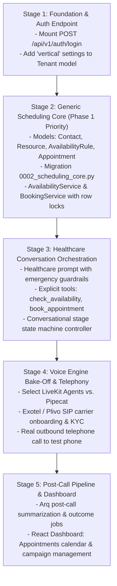

### Stage 1: Foundation & Auth Completion (Days 1–2)
- Mount `app/api/v1/auth.py` exposing login and token refresh using existing `app/core/security.py` functions.
- Update `Tenant` model to support clinic metadata (`vertical = "healthcare"`).
- Submit carrier KYC documentation on Day 1 for Exotel and Plivo.

### Stage 2: Generic Scheduling Subsystem (Days 3–5)
- Implement models in `app/models/`: `Contact`, `Resource`, `AvailabilityRule`, `AvailabilityException`, `Appointment`.
- Create and execute Alembic migration `0002_scheduling_core.py`.
- Add composite unique index `(tenant_id, resource_id, start_at)` on active appointments.
- Build `AvailabilityService` (slot calculations) and `BookingService` (`SELECT ... FOR UPDATE` row locks).
- Write concurrency unit tests proving zero double-bookings under 20 simultaneous threads.

### Stage 3: Healthcare Conversation State Machine (Days 6–8)
- Author clinical system prompt: Hindi/English code-switching, zero medical advice, emergency redirection.
- Build auditable function calling tools: `check_availability` and `book_appointment`.
- Implement conversational stage controller: Greeting $\rightarrow$ Recording Consent $\rightarrow$ Patient Identity Verification $\rightarrow$ Slot Retrieval $\rightarrow$ Mandatory Read-Back Confirmation $\rightarrow$ Booking.

### Stage 4: Voice Framework & Live Telephony Call (Days 9–12)
- Wire selected voice framework (LiveKit Agents or Pipecat) to the `VoiceEngineSession` interface.
- Implement carrier SIP trunk connection (`ExotelTelephonyAdapter` or `PlivoTelephonyAdapter`).
- **Phase 1 Exit Milestone**: Execute a real outbound phone call to a team mobile phone that checks doctor availability, reads back the appointment details, and commits the booking to PostgreSQL.

### Stage 5: Post-Call Analytics & React Dashboard (Days 13–16)
- Register Arq background jobs: `process_call_summary`, `classify_outcome`, `send_sms_confirmation`.
- Expand React frontend: Login page, appointment calendar view, doctor availability editor, and call history player.

---

# Section 18 — Glossary

Beginner-friendly explanations of every core software engineering concept used throughout this platform:

- **API (Application Programming Interface)**: A standardized contract that allows two computer programs to talk to each other. The React frontend uses an API to ask the FastAPI backend for data over HTTP.
- **Endpoint**: A specific digital address on a server (e.g., `/api/v1/voice/turn`) where an API listens for requests to perform a specific action.
- **Request**: A digital message sent by a client (like a browser or phone carrier) asking the server to do something, often carrying data.
- **Response**: The server’s reply back to the client containing an HTTP status code (e.g., 200 OK) and data (e.g., JSON or audio).
- **Middleware**: Software code that intercepts every incoming request before it reaches the endpoint, performing universal tasks like logging, security validation, or adding request IDs.
- **Authentication**: The process of verifying *who you are* (e.g., verifying that an email and password match a registered user).
- **Authorization**: The process of verifying *what you are allowed to do* (e.g., confirming that an operator can view appointments but cannot delete clinic billing records).
- **Tenant**: An isolated organization or company using the software. In this system, each clinic is a separate tenant with private data.
- **ORM (Object-Relational Mapping)**: A software library (like SQLAlchemy) that lets developers query and manipulate database tables using Python classes and objects instead of writing raw SQL strings.
- **Migration**: A version-controlled script (managed by Alembic) that tracks and applies changes to the database structure (such as adding new tables or columns) over time.
- **Transaction (ACID)**: A group of database operations that execute as a single unbreakable unit. Either *all* operations succeed, or if one fails, *everything* rolls back to the beginning, leaving the database completely clean.
- **Concurrency**: The ability of a system to handle multiple tasks or user requests at the exact same time without crashing or corrupting data.
- **Idempotency**: A property of an operation meaning that performing it multiple times produces the exact same result as performing it once. Prevents charging a card twice or booking two appointments when a network webhook is retried.
- **Webhook**: An automated HTTP callback where an external service (like Exotel) sends data to our server the instant an event happens (e.g., when a patient answers a phone call).
- **Queue**: A first-in, first-out list (hosted in Redis) that holds background tasks waiting to be processed by workers.
- **Worker**: A background program (running Arq) that continuously pulls tasks from the queue and executes them outside the user-facing web request.
- **STT (Speech-to-Text)**: An AI technology that listens to human voice audio and converts the spoken words into written text.
- **TTS (Text-to-Speech)**: An AI technology that converts written text into natural-sounding spoken audio.
- **LLM (Large Language Model)**: An advanced AI reasoning engine (such as Google Gemini) that understands context, conversational intent, and generates human-like responses.
- **VAD (Voice Activity Detection)**: An algorithm that detects whether audio contains human speech or silence, allowing the system to know when a caller has started or finished speaking.
- **Object Storage**: A cloud storage system (like AWS S3) designed to store massive, unstructured binary files like audio recordings and images cheaply and securely.
- **Adapter**: A software design pattern that creates a universal interface around external providers. If you change providers from Google to Deepgram, only the adapter changes; the rest of the application remains untouched.
- **Orchestrator**: A central service that directs and coordinates multiple independent components (STT, LLM, TTS, DB) in the correct chronological order to complete a larger task.
- **Service Layer**: The section of backend code where actual business rules and logic live, kept separate from API routing and database queries.
- **Connection Pool**: A pre-warmed cache of database connections kept open so the application does not waste time opening and closing connections on every single web request.
- **Database Index**: A specialized, sorted lookup data structure (like the index at the back of a textbook) that allows the database to find specific rows instantly without scanning millions of records.
