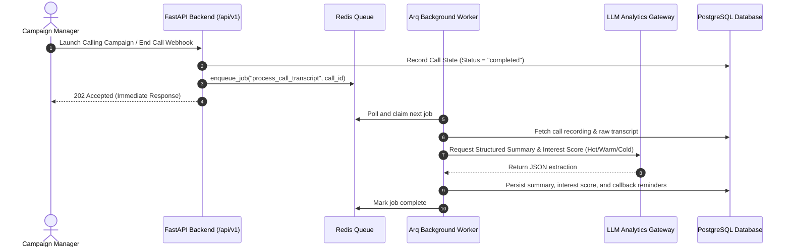

# Background Processing Architecture (Redis & Arq)

## 1. Rationale for Arq over Celery

The reference application utilized Celery dependencies alongside an in-process Python thread queue. For the new enterprise platform, we standardise on **Arq** backed by **Redis 7**:

| Dimension | Celery + RabbitMQ/Redis | Arq + Redis |
|---|---|---|
| **Concurrency Model** | Multiprocessing prefork / threads | Native Python `asyncio` event loop |
| **I/O Efficiency** | High overhead for async tasks | Zero overhead for async HTTP / DB / LLM calls |
| **Complexity & Footprint** | Heavy broker configs, AMQP protocols | Minimal, single Redis instance for both cache & tasks |
| **Typing & Serialization** | Custom JSON/Pickle serializers | Native Python dataclasses, MsgPack performance |

---

## 2. Background Task Pipeline



---

## 3. Worker Configuration & Operation

1. **Worker Class**: Defined in `app/workers/worker.py` using `WorkerSettings`.
2. **Job Execution**:
   ```bash
   arq app.workers.worker.WorkerSettings
   ```
3. **Graceful Lifecycle**:
   - `on_startup`: Pre-warms database connection pools.
   - `on_shutdown`: Waits for in-flight tasks to complete within the grace timeout (default 300s).
   - `keep_result`: Retains task outcomes in Redis for 1 hour for inspection and debugging.

