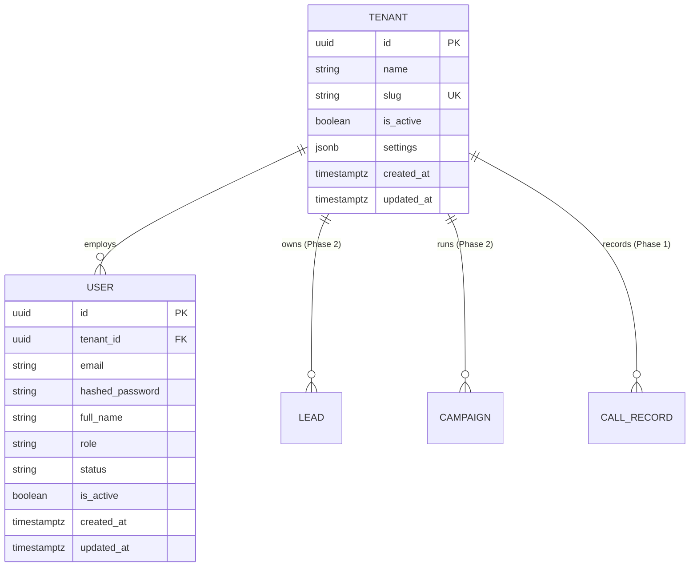

# Multi-Tenant Architecture & Data Isolation

## 1. Principles of Multi-Tenancy

The platform serves multiple business clients (tenants) simultaneously from a shared application deployment. The architecture guarantees:
1. **Zero Data Leakage**: No tenant can query, view, or modify another tenant's leads, campaigns, users, or call recordings.
2. **Tenant-Aware Database Design**: Every table holding business data explicitly references a `tenant_id` foreign key.
3. **Application-Layer Enforcement**: Isolation is enforced at the database query and service layers, never left to client-side filtering.

---

## 2. Foundational Database Schema

### Table Conventions:
- **Primary Keys**: Randomly generated UUID v4 keys prevent sequential ID enumeration attacks.
- **Unique Constraints**: User email uniqueness is constrained per tenant (`uq_users_tenant_email` on `tenant_id, email`), allowing the same individual to have accounts across distinct organizations if needed.
- **Cascading Deletions**: Deleting or deactivating a tenant cleanly handles dependent organizational records.

---

## 3. Tenant Resolution & Dependency Injection

Tenant context is established through FastAPI's dependency injection (`app/api/deps.py`):
1. **JWT Subject Validation**: The authenticated user's JWT token carries an immutable `tenant_id` claim.
2. **Header Guard (`X-Tenant-ID`)**: When specified in administrative contexts, the server validates that the requested tenant matches the caller's authorized tenancy.
3. **Service Layer Scope**: All repository and service queries receive the resolved `tenant_id` and apply `.where(Model.tenant_id == tenant_id)`.

