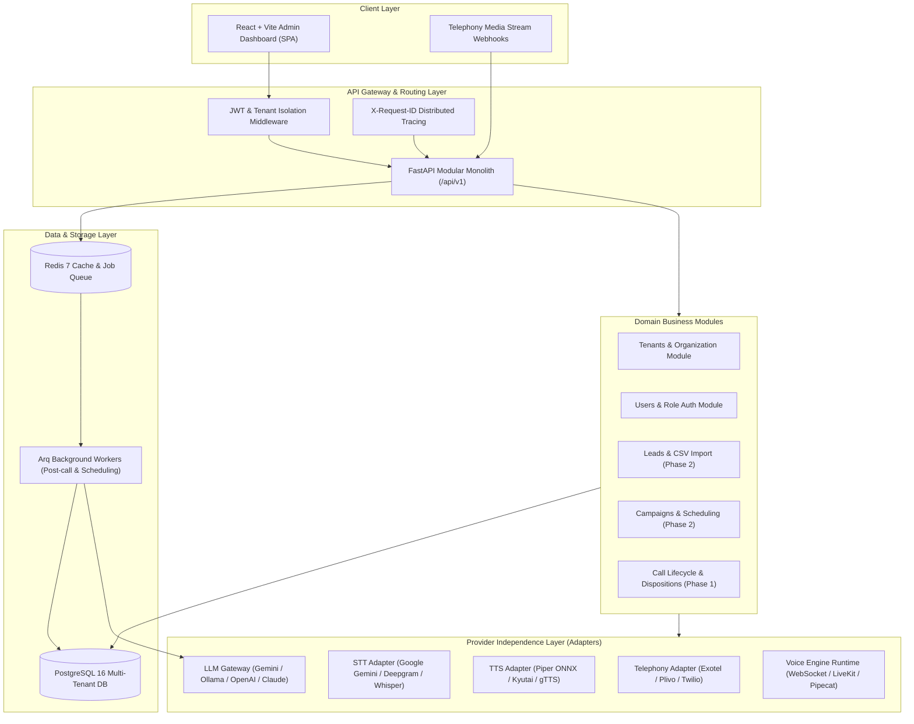

# System Architecture Overview

## 1. Executive Summary

The **AI Voice Agent Platform** is an enterprise-grade, multi-tenant system designed to automate outbound voice calling campaigns for businesses. The platform enables organizations to upload customer contact leads, launch conversational voice agents that speak fluent English, Hindi, and Hinglish, record and transcribe calls, extract structured conversation outcomes, and view analytics via an operational dashboard.

---

## 2. Architectural Paradigm: Modular Monolith

Rather than beginning with distributed microservices—which introduce network latency, operational overhead, and distributed transaction complexity—the platform is designed as a **Modular Monolith**.

### Key Advantages:
1. **Single Deployable Unit**: Simplified CI/CD pipeline, unified local development environment, and zero inter-service network latency during call setup.
2. **Strict Module Boundaries**: Each domain (`tenants`, `users`, `leads`, `campaigns`, `calls`, `voice`) owns its services and schemas. Modules communicate via clear interfaces and services.
3. **Prepared for Decomposition**: Should specific services (such as the voice streaming pipeline or high-volume campaign schedulers) require horizontal scaling independently, clean module boundaries enable seamless extraction into dedicated microservices later.

---

## 3. Technology Stack Reference

| Layer | Selected Technology | Architectural Justification |
|---|---|---|
| **Language** | Python 3.11 / 3.12 | Industry standard for AI, speech synthesis, and asynchronous web services. |
| **Framework** | FastAPI 0.115+ | High-performance asynchronous ASGI framework with automated OpenAPI documentation and Pydantic v2 validation. |
| **Database** | PostgreSQL 16 | ACID-compliant relational storage with JSONB support, indexing, and foreign-key isolation. |
| **ORM & Migrations**| SQLAlchemy 2.0 + Alembic | Robust 2.0 mapped typing, async queries, and versioned database schema migration control. |
| **Task Queue** | Redis 7 + Arq | Lightweight, asynchronous Redis-backed background job queue avoiding heavy Celery complexity. |
| **Frontend** | React 18 + Vite + TS | High-speed SPA with TypeScript strict mode, React Router, and TanStack Query caching. |
| **UI Components** | Tailwind CSS + shadcn/ui | Accessible, highly customizable design system without rigid third-party component lock-in. |
| **Containers** | Docker & Docker Compose | Multi-container reproducible development and production environment definitions. |

