# Voice Engine Architecture: Reuse & Adaptation Strategy

> **Source Reference:** `virtual-buddy-backend` repository.

This document details the architectural assessment of the existing voice companion codebase, identifying proven components harvested for reuse, components adapted for business voice agents, and legacy features intentionally discarded.

---

## 1. Component Assessment Matrix

| Component | Status in Reference Code | Strategy for New Platform | Rationale |
|---|---|---|---|
| **STT Provider Interface** | `STTProvider` in `app/modules/audio/base.py` | **Adopted as Clean Adapter** | Proven strategy pattern allowing swappable STT backends. |
| **Google Gemini STT** | `GoogleSTTProvider` (`providers/google_stt.py`) | **Adopted for Audio Transcriptions** | Works well for asynchronous call audio transcription. |
| **Piper Neural TTS** | `PiperTTSProvider` (`providers/piper_tts.py`) | **Primary Outbound Call TTS** | Low latency (50-150ms), runs on CPU via ONNX, supports English and Hindi (`hi_IN-pratham-medium`). |
| **Kyutai Pocket TTS** | `KyutaiTTSProvider` (`providers/kyutai_tts.py`) | **Optional Cloned Persona Adapter** | High-fidelity zero-shot voice cloning from short audio reference files. |
| **Streaming Thought Scrubber**| `StreamingThoughtScrubber` (`reflection.py`) | **Harvested to Core Utils** | Essential for stripping `<thought>` tags in real-time before sending to TTS. |
| **Sentence Chunker** | `extract_complete_sentences` (`text_chunking.py`) | **Harvested to Core Utils** | Crucial for streaming token pipelining while protecting decimals (3.14) and abbreviations (Dr., Mr.). |
| **TTS Text Sanitizer** | `sanitize_text_for_tts` (`reflection.py`) | **Harvested to Core Utils** | Cleans markdown symbols, emojis, and tables into spoken prose. |
| **ChromaDB Vector Store** | `vector_store.py` (Per-user memory) | ❌ **Discarded** | Outbound calling needs script/knowledge-base grounding, not personal companion memories. |
| **Emotion Engine (PAD model)**| `emotion_engine.py` | ❌ **Discarded** | Pleasure/Arousal/Dominance companion modeling is not applicable to business campaign agents. |
| **Friend Prompts / Onboarding**| `prompts.yaml`, `onboarding/` | ❌ **Discarded** | Companion persona replaced with campaign agent scripts and business goal frameworks. |

---

## 2. Adapters & Provider Boundaries

To prevent coupling the platform to any single telephony or AI provider, the architecture implements five clean adapter boundaries:

```mermaid
classDiagram
    class STTProvider {
        <<interface>>
        +transcribe(audio, content_type, language) STTResult
    }
    class TTSProvider {
        <<interface>>
        +synthesize(text, language, voice) TTSResult
    }
    class LLMGateway {
        <<interface>>
        +complete(messages, temperature, max_tokens) str
        +stream(messages, temperature, max_tokens) AsyncGenerator
    }
    class TelephonyProvider {
        <<interface>>
        +initiate_call(from_number, to_number, stream_webhook_url) CallSession
        +terminate_call(provider_call_id) bool
    }
    class VoiceEngineSession {
        <<interface>>
        +start(stt, tts, llm, system_prompt, greeting) void
        +stop() void
    }

    STTProvider <|-- GoogleSTTAdapter
    STTProvider <|-- DeepgramSTTAdapter
    STTProvider <|-- MockSTTAdapter

    TTSProvider <|-- PiperTTSAdapter
    TTSProvider <|-- KyutaiTTSAdapter
    TTSProvider <|-- ElevenLabsTTSAdapter

    LLMGateway <|-- GeminiLLMAdapter
    LLMGateway <|-- OllamaLLMAdapter
    LLMGateway <|-- OpenAILLMAdapter

    TelephonyProvider <|-- ExotelTelephonyAdapter
    TelephonyProvider <|-- PlivoTelephonyAdapter
    TelephonyProvider <|-- TwilioTelephonyAdapter

    VoiceEngineSession <|-- CustomWebSocketSession
    VoiceEngineSession <|-- LiveKitAgentsSession
    VoiceEngineSession <|-- PipecatSession
```

---

## 3. Evaluation Strategy for Voice Frameworks (LiveKit vs Pipecat)

The platform does not prematurely lock into LiveKit Agents or Pipecat during initialization:
- **Evaluation Criteria**:
  1. *Turn-taking latency*: Time-To-First-Audio (TTFA) target < 700ms.
  2. *Interruption / Barge-in handling*: Precision of Silero VAD cancellation on 8kHz telephony audio.
  3. *Indian Telephony Integration*: Ease of connecting SIP / WebSocket media streams from **Exotel** and **Plivo**.
  4. *Infrastructure footprint*: Resource consumption of worker instances under 50 concurrent calls.
- Both frameworks will be tested against the `VoiceEngineSession` interface in Phase 1 before choosing a default deployment runtime.

